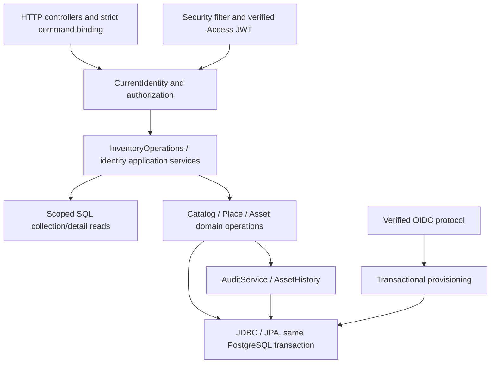

# Backend architecture and domain audit

**Historical executable-source audit, human reviewed.** Findings/test results describe the audited implementation. Its former query/account recommendations are not active normative requirements: use [DOMAIN.md](../../DOMAIN.md), [ARCHITECTURE.md](../../ARCHITECTURE.md) and [the consolidated future gates](../plans/COLLECTION_QUERY_IMPLEMENTATION_PLAN.md). Supported-write/security/history evidence remains preserved.


Date: 2026-10-11. Status: **ANALYSIS / HUMAN REVIEW GATE**; no implementation authorized. Phase A is accepted/frozen; Phase B is HUMAN ACCEPTED / CLOSED as of this date. C, D and the mandatory collection-query backlog remain separately gated.

## 1. Executive assessment

**CONFIRMED:** the existing modular monolith has sound supported creation and mutation boundaries: signed identity, explicit authorization, persisted target ownership, transactional reference validation, PostgreSQL structural constraints and atomic administrative/business history. This audit found no demonstrated cross-Tenant authorization bypass, broken creation transaction or required new creation endpoint. Preserve these mechanisms rather than replacing them.

**INFERRED:** the original Assets/Locations/Owners “cannot create” report can plausibly arise entirely from Global aggregate context lacking a concrete Tenant. **UNKNOWN:** the operator's precise failing step; successful isolated backend tests do not reproduce that UI report. Phase C should begin with bounded context/CTA/form/request diagnosis, not a backend rewrite.

**CONFIRMED product gaps:** Users lacks pagination; Catalog/Places/Audit lack selectable sorting; Products lacks useful reference/manufacturer-number filters; Audit lacks actor/date filtering. Existing pagination on Categories, Manufacturers, Products, Locations, Owners, Assets and Audit is real SQL pagination. These gaps remain mandatory despite Phase B closure. Existing direct SQL services can be extended coherently; no generic query framework is necessary.

**CONFIRMED design debt:** inconsistent auth/admin versus inventory problem codes, duplicated secured application adapters, untyped map read projections, and historical documentation that still describes earlier phase boundaries. The actor-username requirement is a new contract gap: GLOBAL canonical login exists; TENANT username does not. No username claim is inferred.

Full Maven verification: **74 unit + 241 PostgreSQL integration tests passed; 0 failures, 0 errors, 0 skips; BUILD SUCCESS**. Evidence does not prove every possible attack/concurrency schedule or real IServ interoperability. No manual environment request, deployment change, database reset or persistent business-data creation was performed.

## 2. Actual backend architecture map

Reviewed ARCHITECTURE.md, DOMAIN.md, CODEX_IMPLEMENTATION_TASK.md; ADRs 0002–0005; authentication operations; current repair plan/B.4 matrix; OpenAPI; executable application/security/query/domain services; V1–V6 in order; unit/integration assertions. Historical phase statements in ADRs are not current endpoint capability claims.

Source shorthand below is relative to `backend/src/main/java/com/github/ksewen/kelios/`: `security/` means `platform/security/`, `auth/` means `identity/auth/`. Tests are under the matching `backend/src/test/java/com/github/ksewen/kelios/` path; IdentityAuthenticationIT, Phase3InventoryIT and Phase4MetadataIT are in `identity/auth/`, DomainFoundationIT in `inventory/`. Migration references mean `backend/src/main/resources/db/migration/`. Method names locate compressed source precisely where a line spans multiple operations.



**CONFIRMED responsibilities and limits:**

| Abstraction | Owns | Does not own | Evidence |
|---|---|---|---|
| Identity / CurrentIdentity | Validated signed UUID/scope/Tenant/role/status/display principal; SecurityContext lookup | Selected UI Tenant, live membership recalculation, username, repository authority | auth/Identity.java:8–18; security/CurrentIdentity.java; JwtTokens.verify |
| Actor | Trusted historical UUID/display value passed internally | Authentication, role checks, resource ownership, username/system-kind model | audit/Actor.java:7–11 |
| Authorization | ACTIVE/ADMIN/GLOBAL predicates, same-Tenant checks, user-management limits/self-protection | Loading target facts, SQL filtering, transaction ownership | auth/Authorization.java |
| InventoryOperations | **Current inventory HTTP application boundary**; scoped reads, persisted ownership, auth and transaction coordination | Controller parsing, generic table framework, browser context state | security/InventoryOperations.java:19–56 |
| SecuredDomainOperations | Earlier supported application adapter, including internal Asset delete; authorizes Phase 1 operations | Current controller dispatch, a public delete/restore API | security/SecuredDomainOperations.java; IdentityAuthenticationIT.scopedServiceBoundariesAndServerActorsPreserveDomain |
| Domain services | Domain guards, locks, reference validation, writes and history coordination | JWT parsing or trusting client actor/ownership fields | CatalogService, PlaceService, AssetService |
| ListInput / Page | Parameter allowlists, bounded paging, UUID/bool/literal-search parsing; items/page/size/totalElements | Scope policy, selectable sorts on every resource, cursor/snapshot guarantees | platform/ListInput.java:5–14; Page.java:3 |
| InventoryReads / AuditReads | Parameterized scoped SQL predicates/count/order/page and detail projection | Authentication; accepting scope as proof of authority | InventoryReads.java:9–59; AuditReads.java:8–31; secured callers |
| IdentityStore | User load/administratively scoped load/list, inserts, recovery mutex | OIDC protocol, password policy, general business repository access | auth/IdentityStore.java:10–28 |
| CatalogUsage port | Narrow retained Asset/reference/history inspection for Catalog guards | Inventory commands, authorization, a public cross-module repository | catalog/CatalogUsage.java; inventory/InventoryCatalogUsage.java:10–21 |
| Spring transactions | Shared connection/commit across JPA/JDBC; operation-local locks/version conflicts | Automatic retries, global lock hierarchy, universal serializable consistency | application.yaml; JdbcConfiguration; @Transactional / AuthenticationService TransactionTemplate; ADR0002 |
| StateMachine | Immutable permitted transition graph | Persistence, actor/Tenant policy, events, side effects | engine/statemachine/StateMachine.java; InventoryGraphs.java |

There are no Spring Data repository interfaces defining the live application API. JPA entities are mappings; direct EntityManager and JdbcTemplate implement persistence. SQL table/column selection uses closed enums/whitelists; caller values are bound. Modular separation is package/application-service discipline, not separately deployable services or compiler-enforced Maven modules. **Design debt**, not a reason to add services: two adapters require care to avoid divergent scope/error behavior.

## 3. Domain/module matrix

Every row below is **CONFIRMED** from executable calls. HTTP paths have `/api/v1` prefix. Transaction boundaries listed are supported mutation paths, not a promise that every public internal method authorizes independently.

| Domain/module | API entry / application boundary | Persistence and transaction | History, constraints, important tests |
|---|---|---|---|
| Authentication/identity | AuthController; SecurityConfiguration; AuthenticationService; OidcLogin | IdentityStore/JDBC; local login fresh credential/user checks; refresh reload under SHARE; TransactionTemplate for identity operations | V4 scope/identity/credential constraints; JwtAndBrowserTest; IdentityAuthenticationIT |
| Users | IdentityAdminController `/users`, `/users/global`, approve/role/disable/local-credential; AuthenticationService auth | Administratively scoped persisted target; UPDATE locks/fresh role checks; singleton guard where usability increases | USER_* / LOCAL_CREDENTIAL_CHANGED AuditService same tx; V2/V4; administrationHttpMatrixAndAuthoritativeTargets, userAdministrationRejectsReadersBeforeTargetLookupAndScopesTenantTargets |
| Tenants | IdentityAdminController `/tenants`; GLOBAL ADMIN create; ACTIVE scoped read | TenantService EntityManager; create transaction persists/flushes | TENANT_CREATED attributed to new Tenant; V2 name/PK; IdentityAuthenticationIT administration matrix |
| OIDC/IServ | GET/PUT `/tenants/{id}/oidc` GLOBAL ADMIN; public organization lookup/start/callback | Config parent lock/version; encrypted secret/group writes same tx; verified protocol outside long DB tx; final provisioning config SHARE | OIDC_CONFIG_CHANGED/USER_CREATED; V4 one provider/Tenant/exact identity key; fixture protocol/group/config-race tests |
| Categories | CatalogController collection/detail/create/edit/delete/publish/preview/merge; InventoryOperations | CatalogService JDBC; scope predicate; SHARE references, UPDATE guarded targets | CATEGORY_* audit, UNKNOWN DB guard; V2/V3; complete dependency matrix, retained guards, Phase3 role matrix |
| Manufacturers | Same controller/application boundary, distinct Kind | Same CatalogService; UUID identity and no name uniqueness | MANUFACTURER_*; V2/V3 UNKNOWN guard; Category-equivalent merge/guard tests |
| Products | CatalogController, no Product Merge | CatalogService locks Category/Manufacturer, validates visibility; ordinary edit frozen after usage | PRODUCT_* audit; FK + deferred Asset composite; historical usage test/indexes; creation/dependency and frozen-edit tests |
| Locations | PlaceController concrete-Tenant collection/create, ID detail/edit/delete; InventoryOperations | PlaceService JDBC; scoped ownership; SHARE assignment / UPDATE edits/deletes | LOCATION_* audit; V2 same-Tenant composite FK; referenced Location metadata edits deliberately allowed |
| Owners | Same PlaceController Kind.OWNER | Same transaction; ordinary edit/delete reject retained Asset references | OWNER_* audit; V2 ownership/composite FK; DomainFoundationIT retained-reference tests |
| Assets | AssetController tenant list/register, global list, ID detail and workflow endpoints; InventoryOperations | InventoryReads SQL + AssetService JPA; reference locks and expectedVersion; generated tag counter | AssetHistory in same tx, not duplicate ordinary AuditLog; V2/V6; Phase3 64 graph cases, Phase4 metadata, foundation concurrency |
| AuditLog | AuditController collection/detail; InventoryOperations active admin | AuditReads SQL captured target-Tenant scope BEFORE count/page/detail | AuditService MANDATORY insert; V5 immutable historical attribution/no live Tenant FK; Phase3 attribution/writer tests |
| AssetEvent | AssetController `/assets/{id}/events`; owning Asset authorized first | InventoryReads bounded history; AssetHistory MANDATORY JDBC insert | V2 Asset/Tenant composite FK, V3 append-only; rollback/direct-DML/snapshot tests |
| Merge | CatalogController Cat/Man preview/merge; InventoryOperations GLOBAL ADMIN | Catalog preview read-only/advisory; CatalogMergeService one fresh locking transaction, Product/Asset scans including retained rows | Atomic UPDATED events/source deletion/audit; deferred composite FK; rollback, visibility, independent-connection race tests |

## 4. Identity/authentication model

**CONFIRMED:** local credentials are structurally GLOBAL-only. `local_global_credential(user_id,user_scope)` FK targets app_user(id,scope), with `user_scope='GLOBAL'`; canonical lowercase `login_name` is unique and 3–64 ASCII characters. Passwords implements the approved exact/untrimmed Unicode policy and Argon2id. `AuthenticationService.login:31–44` verifies then rechecks current hash/user under locks; provider selection cannot create local TENANT credentials.

**CONFIRMED:** `OidcLogin.callback:64–86` checks encrypted flow Tenant/state/expiry/config/version/callback binding, verified ID token issuer/subject/audience/nonce/signature and UserInfo subject equality. `OidcProvisioning.complete:15–34` resolves exact `(issuer,subject)`, denies an existing mapping to another Tenant, creates exactly TENANT/USER/PENDING after fresh config/group eligibility, never derives ADMIN. V4 primary/composite keys independently constrain this mapping. Names are presentation, not identity. Organization routing UUID selects authentication configuration; it proves no membership.

**CONFIRMED:** Access is a signed authority snapshot; refresh reloads User and keeps original absolute expiry. PENDING can authenticate/see own minimal status but cannot access business reads/writes. DISABLED cannot login/refresh. Already issued ACTIVE access after disable/demotion remains valid until natural expiry/skew **by accepted design**, not a discovered revocation defect (DOMAIN §2; IdentityAuthenticationIT.existingIdentityKeepsIdDespiteChangedNameAndApprovedThenDisabled/currentDatabaseRefreshRoleAndStatusAndAbsoluteExpiry).

**CONFIRMED:** same-origin HTTPS, memory Bearer, Secure HttpOnly Refresh, exact Origin/signed CSRF on ambient-cookie unsafe auth endpoints, stateless SecurityContext; no HTTP session/revocation store. BrowserTokens:14–60; SecurityConfiguration.security/AuthFilter. Bearer-only business mutations do not rely on refresh cookies for authorization. Provider TLS/DNS/host/size/time policies are in ProviderHttp, not browser routing. **UNKNOWN:** real IServ interoperability, still manual verification pending; deterministic HTTPS fixture is not real-provider evidence.

## 5. Authorization and Tenant model

**CONFIRMED:** `Authorization.readTenant/writeTenant/writeCatalog/manageUser` separates scope/role/status. GLOBAL USER reads across Tenants but never writes. TENANT USER reads own Tenant/visible GLOBAL Catalog only. TENANT ADMIN writes own Tenant and manages ordinary own-Tenant USERs; cannot grant ADMIN/manage other admins/providers/Tenants. GLOBAL ADMIN grants ADMIN and can explicitly act on all authorized targets. All business access first requires ACTIVE.

Selected Tenant is not in JWT, identity membership or a backend session. For a new Tenant-owned record the URL Tenant is an explicit **requested target**, checked against signed authority and Tenant existence. For an existing record the authoritative target is loaded:

- Asset: InventoryOperations.assetTenant:24 -> scoped InventoryReads.tenantOf -> AssetService expected Tenant/version.
- Catalog: InventoryOperations.writable:40 -> scoped locked entry -> writeCatalog using persisted tenantId. Publication can change Catalog ownership, so UPDATE lock precedes authorization; fresh visibility is checked after waits.
- Place: InventoryOperations.editPlace/deletePlace:52–53 -> scoped persisted Place -> writeTenant -> same immutable Tenant in locked service write.
- User: IdentityStore.managed -> authenticated administrative scope -> freshly locked target -> manageUser, not caller-supplied ownership.

**CONFIRMED:** strict CommandInput rejects forged tenant/actor/tag/version/state fields where not approved command inputs. Product references are loaded and SHARE-locked; GLOBAL Products require GLOBAL parents, Tenant Products require GLOBAL/same-Tenant parents. Asset Product selection derives Category/Manufacturer and detects changed dependencies; direct refs must be visible, Location/Owner must match authoritative Asset Tenant. Out-of-scope selection fails before mutation. V2 same-Tenant place FKs and Product composite equality add independent protection; cross-Tenant Catalog visibility is application-enforced under locks.

No traced supported mutation bases its authority solely on request-body ownership. Global aggregate browsing is not a wildcard create target. An explicitly addressed persisted Asset may still be modified by GLOBAL ADMIN under its existing cross-Tenant authority; this is distinct from creating Tenant-owned data with no target Tenant. No frontend visibility is a backend grant.

**UNKNOWN:** exhaustive hostile request/permutation coverage. Tests establish meaningful examples, not mathematical proof. No exploit/precondition supporting a security defect was established, so no security implementation gate is being invoked or bypassed.

## 6. Creation workflow matrix

All HTTP paths use verified CurrentIdentity via SecurityConfiguration, ACTIVE checks and the application boundary. Text/UUID validation is server-side. A new record has no persisted owner to load: the authorized explicit creation context becomes ownership. This is not trusting a forged owner of an existing target.

| Workflow | Complete executable path | Classification |
|---|---|---|
| Category | POST global/Tenant catalog -> CatalogController.createCategoryIn (name allowlist) -> InventoryOperations.createCategory -> writeCatalog + Tenant require -> CatalogService.createLabel tx -> UUID/normalized name/visibility INSERT -> CATEGORY_CREATED target ownership audit -> 201 Location + id | **SOUND**; GLOBAL create requires GA, Tenant create own ADMIN or GA |
| Manufacturer | Same distinct endpoint/Kind -> createManufacturer -> identical ownership/name/transaction validation -> manufacturer INSERT + MANUFACTURER_CREATED -> 201 id | **SOUND** |
| Product | POST Catalog name/categoryId/manufacturerId/number -> createProduct -> writeCatalog/Tenant -> CatalogService.createProduct:91–98 -> locked live visible parents -> INSERT with derived ownership -> PRODUCT_CREATED snapshot -> 201 id | **SOUND WITH UX/PRECONDITION CONSTRAINT**: valid visible parents mandatory; names/number not unique |
| Location | POST `/tenants/{tenant}/locations` name -> PlaceController:13 -> InventoryOperations.createPlace -> writeTenant/Tenant existence -> PlaceService.create:43–45 -> INSERT+LOCATION_CREATED same tx -> 201 id | **SOUND WITH UX/PRECONDITION CONSTRAINT**: concrete Tenant and ADMIN |
| Owner | Same Kind.OWNER endpoint -> identical checks -> owner INSERT+OWNER_CREATED -> 201 id | **SOUND WITH UX/PRECONDITION CONSTRAINT**: concrete Tenant and ADMIN |
| Asset | POST tenant/assets approved fields -> AssetController:16/CommandInput.catalog -> writeTenant/Tenant/scoped selection -> AssetService.register:69–79 -> locked/derived Catalog + same-Tenant places -> atomic UTC tag -> JPA persist/flush REGISTERED/UNKNOWN/no loan + REGISTERED snapshot -> 201 full View/Location | **SOUND WITH UX/PRECONDITION CONSTRAINT**: Tenant, Location, explicit loanable; Product or direct Category+Manufacturer; Owner optional |
| Tenant | POST tenants name -> IdentityAdminController:18 -> active GA -> TenantService.create:14–18 -> normalized nonblank name/JPA flush -> TENANT_CREATED new Tenant attribution -> 200 UUID | **SOUND** with existing distinct HTTP response convention |
| GLOBAL user | POST users/global login/display/password -> IdentityAdminController -> AuthenticationService.createGlobal:53–59 -> GA, policy/hash -> TransactionTemplate -> GLOBAL/USER/ACTIVE User + unique credential -> USER_CREATED -> 200 Identity | **SOUND**; ADMIN grant separate |
| TENANT provisioning | Verified OIDC callback only -> OidcProvisioning.complete -> fresh locked provider/version/groups -> exact identity reservation + deferred FK -> new USER/PENDING + USER_CREATED -> User lock/disabled guard -> JWT pair/callback redirect | **SOUND**; no arbitrary Tenant-user create/body-identity endpoint |

**CONFIRMED:** required audit/event writers participate in each supported creation transaction. Internal `UserService.create` is a Phase1 foundation/fixture API with no credential/approval/audit contract; it is not the HTTP provisioning path. Do not expose it as an alternative account-creation mechanism.

**INFERRED / Phase C implication:** frontend Assets CTA requires admin+Tenant (`pages.tsx:110`); Management places require Tenant and show context guidance (`:135,153`); Registration sends tenant-owned POST (`:99–101`). Thus the reported creation restriction is consistent with correct context requirements. **UNKNOWN:** whether operator had selected a Tenant, reached a form, supplied a valid Location/reference/loanability, or received a server error. No new runtime records were created to settle that question.

## 7. Collection/query capability matrix

**CONFIRMED executable contracts**, not controller-name inference. Prefix `/api/v1`; `t` is an authorized concrete Tenant. P = bounded zero-based offset `page`, default size25/max100, response items/page/size/totalElements; hasNext derived, not a separate backend field. Fixed ordering is globally correct but does not make a header interactively sortable.

| Resource | Endpoint / implementation | Paging / requirement | Filters combined in one WHERE | Order/direction and coherent query | Frontend / remaining mandatory gap |
|---|---|---|---|---|---|
| Categories | `/catalog/categories`, `/tenants/t/catalog/categories`; CatalogService.list:160–169 | P / REQUIRED, present | literal name q, visibility, deleted; global-only or GLOBAL+ownTenant scope | fixed name,id ASC; count+page same predicates; selectable sort absent | explicit applied Name + real pager; add selectable Name/Visibility/direction |
| Manufacturers | corresponding manufacturers; same list Kind | P / REQUIRED, present | same | same | same; manufacturer number is not a Manufacturer field |
| Products | corresponding products; same list Kind | P / REQUIRED, present | same; no Category/Manufacturer/number filter | same | add Name/Visibility/number sort + useful combined refs/number filters |
| Locations | `/tenants/t/locations`; PlaceService.list:63–69 | P / REQUIRED, present | Name q, deleted + mandatory Tenant | fixed name,id ASC | explicit applied Name/pager; selectable Name/direction missing |
| Owners | `/tenants/t/owners`; same Kind | P / REQUIRED, present | same | same | same |
| Assets | `/tenants/t/assets`, GLOBAL `/assets` optional tenantId; InventoryReads.list:25–42 | P / preserve, present | identifier q OR tag/serial/local/external; AND lifecycle/condition/loaned/ref UUIDs; scoped references | selectable tag/createdAt/lifecycle/condition ASC/DESC + UUID same direction; full filter/order before page | applied multi-field filter, real header sort/pager; sufficient current contract |
| Users | `/users`; AuthenticationService.list:60–63 -> IdentityStore.list:25–28 | **unbounded array / REQUIRED, absent** | only administrative authorization predicate; no caller filters | fixed UUID order, no selectable sort/page/count | honest unpaged rows; add bounded combined query and metadata, no client slicing |
| Audit | `/audit-log`; AuditReads.list:12–23 | P / REQUIRED, present | action/targetType/targetId + captured tenantId or globalOnly; Tenantadmin scope forced | fixed occurredAt,id DESC; same scoped count/page; selectable order absent | explicit combined filters/pager; add actor/date and selectable order |
| Tenants | `/tenants`; TenantService.list:23–27 | array / NOT REQUIRED currently | signed scope only | fixed UUID order | intentional small list; no parity-driven backend work |
| IServ config | `/tenants/t/oidc`; OidcConfigurationService.get/put | one record/Tenant / NOT REQUIRED | not a list query | versioned configuration, no table sort needed | distinct form; no fabricated paging |

Anonymous `/auth/oidc/organizations` **is** a bounded name/page routing-directory query (OidcConfigurationService:22–31), not the provider-administration collection or business membership list. AssetEvent history is separately paged, fixed occurredAt/id DESC, no q.

**CONFIRMED:** authorization/context -> constrain full collection -> predicates -> stable order -> SQL LIMIT/OFFSET. Count and page are two SQL statements using the same predicate. READ COMMITTED does not give one shared snapshot for those statements; concurrent inserts/deletes can change counts or page membership. ADR0004 explicitly disclaims snapshot-consistent pagination. UUID tie-breakers provide deterministic order for an unchanged collection, not cursor/snapshot immunity to concurrent writes. **Approval question:** only add stronger consistency if product needs it; do not silently promise it or replace offset paging speculatively.

**CONFIRMED:** shared ListInput is adequate for bounded parsing, not a universal collection-policy abstraction. Catalog/Places can add whitelisted orders to current SQL; Users needs a response/API change; Audit extends its own scoped predicates. Their distinct authorization/data shapes justify per-domain query implementations. No arbitrary-page client filtering/sorting or independent-subset combination is recommended.

## 8. Transaction/consistency findings

**CONFIRMED sound boundaries:**

- InventoryOperations/domain methods use REQUIRED transactions; JPA/JDBC participate in the same Spring database transaction. AuditService.record and AssetHistory.append are MANDATORY, not REQUIRES_NEW. Entity flush before history does not commit independently. AuthenticationService uses TransactionTemplate for User/credential/audit atomicity.
- Asset mutation uses expectedVersion + JPA @Version; winning flush/history commits together, loser rolls back. Dependency and snapshot reads hold relevant SHARE locks; stale Product dependency reread yields conflict rather than silently accepting mismatched derived facts.
- Catalog/Owner guarded edits/deletion lock target UPDATE then query retained references; new assignment holds parent SHARE. Product history freezes ordinary editing even after current references disappear. Place Location rename is deliberately permitted while referenced.
- Merge: lock source/target in UUID order; fresh retained Product rows then Asset rows; validate target visibility and dependent invariants; refresh locked JPA Asset; redirect + UPDATED history + source soft-delete + administrative audit; deferred Product composite checked at commit. Preview is read-only, reserves nothing and is not consumed as execution authority.
- Provider put locks Tenant for first insert/config UPDATE, checks expected version, replaces groups and sanitized audit atomically. Final JIT locks config SHARE and rechecks version/eligibility. Recovery guard serializes zero-usable-admin creation with relevant usability-increasing admin operations.

Evidence: DomainFoundationIT.injectedHistoryAndAuditFailuresRollbackWholeCommands:199–213; incoming-reference/delete/edit/Merge independent-connection tests:280–459; Phase3InventoryIT.eventFailureRollsBackWorkflow:127 and independentConnectionsCompeteWithoutLostUpdate; IdentityAuthenticationIT credentialResetWinsAgainstLoginFromOldHash/configurationChangeWinsAgainstWaitingJit/recoverySerializesWithAdminPromotion; Phase4MetadataIT.independentConnectionsMetadataVersusMergeHasOneWinner.

**No confirmed mutation-without-required-history or orphan-history commit path was found in supported HTTP writes.** Tests inject history/audit failure into representative operations, not every writer. Identity creation failure-injection coverage should be added if that surface changes.

**CONFIRMED intentional limits:** locks are operation-specific; deadlock/10-second lock timeout produces conflict and rollback, not universal deadlock freedom or automatic retry. Place/Catalog metadata writes serialize but generally have no expected-version contract: last permitted unreferenced edit wins. This is design behavior, not an evidenced lost-update violation of an approved version rule. No immutable ownership transfer exists for Place/Asset; their ownership read before lock does not race a supported Tenant reassignment.

**UNKNOWN:** all possible interleavings and deployment failure schedules. Direct privileged SQL can bypass application-enforced visibility/history policies; it is outside the supported command boundary. Do not introduce locks/triggers everywhere merely for arbitrary SQL defense.

## 9. Audit/history findings

**CONFIRMED:** AuditService:20–22 writes actor UUID/display snapshot separately from explicit authoritative target tenantId. Creation uses new target; existing commands loaded target; publication pre-publication ownership; Merge source ownership. V5 nullable tenantId is known GLOBAL/null versus known Tenant UUID, not an unknown attribution state. AuditReads constrains Tenant ADMIN equality before count/select/detail, no live actor/target join; out-of-scope detail equals absent. Phase3InventoryIT.auditQueryAttributionNotActorAndNoExistenceOrCountLeak:101–107 and allAdministrativeWriterVariantsAndSecretsExcluded:115–126 verify this.

**CONFIRMED:** AuditLog snapshots are stored historical values. Actor comes from Access display snapshot (accepted JWT freshness semantics), not a current User join. AssetEvent separately contains immutable before/after IDs and display facts, retains history after later label/reference changes and uses a same-Tenant Asset FK. Ordinary Asset business changes do not duplicate administrative audit; Merge deliberately coordinates both histories.

**CONFIRMED Phase D gap:** canonical GLOBAL account login is `local_global_credential.login_name`, separate from app_user.display_name. Administrative credential reset can rename login. Neither Identity nor Actor nor persisted audit actor fields includes login. TENANT external_identity contains exact issuer/subject, not username; OidcLogin reads UserInfo `name` for display, falling back to subject as display only when absent in provisioning. This does **not** establish a username contract. Current frontend `Audit` at pages.tsx:165 renders actorDisplayName, and no inspected backend code asserts it is a username. “Manual Review Administrator” is a display snapshot.

Phase D must approve trusted human account-label semantics for TENANT, then acquire/snapshot GLOBAL login and approved TENANT label at event creation alongside immutable UUID and optional display. Preserve historical meaning after rename/delete without required live User FK. Do not choose sub/email/name/preferred_username as username by guess. Snapshot enrichment can be transactional without broad JWT redesign; concurrent credential rename needs deliberate acquisition semantics/tests.

**CONFIRMED:** supported writers currently use human Actor, including bootstrap/JIT. No distinct system/service actor-kind representation or supported background actor writer was found. **UNKNOWN:** future system actor needs. Do not fabricate a system username or bypass UUID requirements. AssetEvent and AuditLog must remain separate; extending one does not implicitly authorize rewriting the other.

## 10. Database constraint findings

Read migration sequence: V1 technical SELECT1; V2 domain foundation/UNKNOWN seeds; V3 narrowly scoped immutable event/UNKNOWN protection; V4 identity/authentication; V5 captured audit attribution (clears only then-disposable old audit); V6 localIdentifier. All source history preserved. Existing disposable application data need not be supported; that does not authorize rewriting migrations.

Enforcement labels: **A DB**, **B transactional application**, **C API/controller**, **D absent**. All entries **CONFIRMED**; absence below distinguishes an intentional boundary from a product gap.

| Invariant | Enforcement / location | Assessment |
|---|---|---|
| User explicit scope/Tenant, role/status/nonblank display | A V2 app_user CHECK/FK; Identity constructor / UserService add application validation | Correct |
| Exact external identity, one mapping/User, Tenant match | A V4 `(issuer,subject)` PK, unique user_id, deferred composite User/scope/Tenant FK; B verified provisioning | Correct; routing never owns account authority |
| Local credential GLOBAL-only/canonical uniqueness | A V4 composite FK/check/unique/regex; B Passwords/AuthenticationService | Correct; password policy/hash usability B, not SQL policy |
| One OIDC config/Tenant and distinct group UUIDs | A V4 PK/FKs; B version check/Tenant lock/secret envelope | Correct; HTTPS/allowed-host policy B, not DB regex |
| Catalog visibility iff Tenant null, target refs exist | A V2 CHECK/FKs | Correct structural invariant |
| Product/Asset Catalog cross-Tenant visibility | B locked CatalogService.requireVisible/AssetService.resolve/Merge | No generic SQL visibility trigger; intentional application boundary |
| Asset Location/Owner same Tenant | A V2 composite FKs, Owner MATCH SIMPLE nullable; B scoped assignment lock/check | Independent DB safeguard |
| Product-derived Asset Category/Manufacturer equality | A V2 deferred composite FK; B server derivation/fresh locks | Correct; nullable Product permits direct refs |
| Asset UUID/Tenant/tag immutability | B restricted commands/JPA non-updatable mappings; C strict body; A tag UNIQUE | No general DB identity-update trigger; deliberate accepted boundary |
| Reference guard / Product-ever-used freeze | B locked fresh scans incl retained rows and indexed event JSON; ordinary DML not globally prohibited | Correct for supported commands |
| UNKNOWN rows protected | A V3 scoped UPDATE/DELETE triggers; B protect() | Correct; no UNKNOWN Product invented |
| Event durability/ownership/object snapshots | A V2 Asset/Tenant FK, JSON object/nonblank actor; V3 UPDATE/DELETE/TRUNCATE rejection; B MANDATORY writer | Correct; actor UUID has no live User FK deliberately |
| Audit captured ownership/actor separation | A V5 column/index; B mandatory explicit writer; immutable entity mapping | No live Tenant/User FK or universal append-only SQL trigger; correct supported-write boundary, not arbitrary DB-admin tamper prevention |
| UTC unique generated Asset Tag | A V2 unique/counter; B atomic allocator / application UUID | Correct; no serial/local/name uniqueness |
| Loan/lifecycle domain graph | A enum/loan-null structural checks; B approved state/loan guards | SQL does not encode all graph transitions; correct service boundary |
| localIdentifier length/characters | A V6 checks; B normalization/code-point validation; C approved command allowlist | Correct nullable/nonunique metadata |
| Business-write history completeness | B same transaction/writers; A event integrity | No general SQL trigger creating business snapshots; no unsupported direct-SQL guarantee |
| Required Users pagination / expanded query contracts | D current missing API capability | Mandatory product gap, not DB inconsistency |

**No confirmed data-integrity defect inside supported writes was established.** Future username/history additions require a new approved additive migration and writer contract, not old-data fallbacks/backfills. Catalog/place/user identity constraints should be tested through raw SQL plus supported writes; do not mistake raw-DML structural tests for proof of every application policy.

## 11. API/error-contract findings

**CONFIRMED:** `/api/v1` JSON, strict inventory command allowlists, RFC9457 ProblemDetail/no-store, safe codes for business validation/conflicts, scoped not-found and bounded Page metadata. Inventory create uses 201/Location/id or full Asset View; Catalog/place edit/delete/publication/Merge204; identity create currently200 UUID/Identity and some void updates200. OpenAPI documents these shapes (paths:251–449,933–1904; schemas:1934–2013,2679–2748). Different historical status conventions are not a new creation failure; do not redesign them cosmetically.

**CONFIRMED design debt with user-visible consequence:** `AuthProblems.problem` has no code while business responses do; frontend authSession.request:88–95 falls back to REQUEST_FAILED. Validation/constraint/version identity errors consequently lack localized actionable classification. Default binding handlers may differ further; exact malformed request coverage is incomplete. Review a small stable sanitized error-code mapping gate, not raw backend exception exposure.

**CONFIRMED latent mapper defect:** `BusinessProblems.auth:12` maps every non401 AuthFailure to FORBIDDEN regardless of status (e.g. a future 404/409). Current main inventory scope denials are 403; this audit did not establish a live creation request returning the wrong status. `SecurityConfiguration.problem` also uses INVALID_INPUT for non401/403/404 statuses such as429. Existing BusinessProblemsTest covers six DB/version classes but not these AuthFailure branches. Preserve status and denial behavior while separately correcting code classification; this is not an authorization bypass.

**CONFIRMED:** query keys/sort/direction values are validated for paged resources, q literal escaped; unknown parameter policy on unpaged Users is not a query contract (controller receives none). Future Users Page changes require OpenAPI + frontend integration, not adding controls to the array alone. Read row maps expose authorized entity data; map/detail/View schemas differ and have no compiler-enforced projection equivalence. Secret-bearing identity tables are never SELECTed into public row maps.

**CONFIRMED:** frontend retries reads after auth refresh but never replays mutation after uncertain response. Network timeout can mean committed outcome unknown; no pre-submit Cancel should be represented as that condition. Backend conflicts advise a fresh explicit command, not automatic replay/idempotency guarantees. No new idempotency token subsystem is proposed.

## 12. Test coverage/gaps and executed verification

Command, from `backend/`:

```sh
MAVEN_USER_HOME="$PWD/../.cache/maven-home" TMPDIR="$PWD/../.cache/tmp" ./mvnw -B verify
```

Executed 2026-10-11; **BUILD SUCCESS**, 42.455s. Surefire/Failsafe XML totals:

| Suite | Executed / passed | Failure/error/skip |
|---|---:|---|
| StateMachineTest | 34 | 0/0/0 |
| AuthPolicyTest | 16 | 0/0/0 |
| JwtAndBrowserTest | 16 | 0/0/0 |
| StatusControllerTest | 2 | 0/0/0 |
| BusinessProblemsTest | 6 | 0/0/0 |
| Unit total | **74** | **0/0/0** |
| IdentityAuthenticationIT | 49 | 0/0/0 |
| Phase3InventoryIT | 97 | 0/0/0 |
| Phase4MetadataIT | 23 | 0/0/0 |
| DomainFoundationIT | 72 | 0/0/0 |
| PostgreSQL integration total | **241** | **0/0/0** |

All four IT classes own PostgreSQL17 Testcontainers and DynamicPropertySource datasource overrides. Their writes/SQL-trigger failure injection/backup-restore are ephemeral isolated fixtures, not operator data. Identity suite uses a deterministic HTTPS OIDC fixture with verified test trust. No test was directed at the manual deployment. Private local log: `.cache/backend-audit/maven-verify.log`; generated XML in ignored backend/target. No keys/passwords/token log copied into this document. No new test/source files.

**CONFIRMED coverage versus limitations:**

| Invariant | Genuine evidence | Gap / architectural limitation |
|---|---|---|
| Exact identity/group/config binding | IdentityAuthenticationIT full HTTPS flow, protocol/group failures, wrongTenant/replay, issuer/subject differences, JIT race/config wait | Fixture is not real IServ; TENANT username contract untested because nonexistent |
| Roles/status/scoped targets | Phase3InventoryIT.roleMatrixAndTenantIsolation; registrationTrustBoundaryAndReferenceSelection; IdentityAuthenticationIT administration/reader/manage-user matrices | Several inventory principals are test-signed constructed identities, intentionally isolating API policy; not end-to-end provider login for every role/path |
| Composite DB constraints / migrations | DomainFoundationIT.sameTenantAndProductCompositeConstraintsAreRealPostgres; IdentityAuthenticationIT.postgresIdentityCompositeConstraintsAndUpgradePreserveFoundation; Phase3/4 populated upgrade tests | Direct SQL proves structural constraints, not all caller authorization; no general DB-admin threat model |
| Atomicity/history | Foundation history/audit trigger failure, Phase3 event failure, Phase4 metadata failure, preserved snapshots | Not failure injection at every identity/create writer; expand when those writers change |
| Retained refs/TOCTOU/concurrent writes | Foundation independent-connection lock-wait schedules, deadlock/timeout, merge/edit/reference races; Phase3 workflow competition; Phase4 metadata/Merge | Strong concrete schedules, not exhaustive deadlock freedom; publication race test specifically exercises older SecuredDomainOperations, so add direct current InventoryOperations HTTP race if changing that path |
| Audit isolation/sanitization | Phase3 ownership attribution/count/detail matrix + every writer family; historical values without live actor | New actor/date/sort filters and username snapshots require new tests; no live deletion-policy implementation |
| Collection query | Phase3 literal search/size/scope + Phase4 Unicode/identifier/reference queries; fixed full-set SQL verified statically | Sparse multi-page duplicate-tie/sort-direction coverage; future Users contract has no current test; frontend intercepted query tests do not prove PostgreSQL order |
| API problems | BusinessProblemsTest mocks InventoryOperations for six exception classifications; real MockMvc/Security IT status assertions | Unit mapper tests do not prove locks/transactions; AuthFailure/code consistency branches missing |

**Mandatory future query tests:** at least three pages with duplicate primary sort values, stable UUID ties both directions, combined predicates and scoped counts, max/invalid page/size, escaped wildcard queries, absent/foreign/deleted references where applicable, empty/beyond-end pages, immutable Tenant authority under forged filters, and no secret projections. Browser tests must separately prove applied filters survive sort/page and pending filters never leak. No excluded frontend/real-backend browser test counted here; frontend suites/build were not rerun for documentation-only work. Existing Phase B evidence is linked rather than claimed as a fresh run.

## 13. Confirmed defects

No confirmed security bypass or supported-write integrity/creation defect was found. Do not turn this assessment into a proof that none can exist.

**CONFIRMED API mapper defect:** the non401 AuthFailure-to-FORBIDDEN branch is not status-correct for all accepted AuthFailure statuses. It is latent in the examined inventory flows, not an exploit. Exact location and smallest separate repair gate: §11; add mapper cases then preserve status while correcting code, with separate approval before source edits.

**CONFIRMED unmet product capabilities**, rather than accidental corruption: Users unbounded collection; missing selectable sorts/expanded Product/Audit predicates; actor login not represented. These require explicit API/product gates (§16/§18), not silent frontend simulation.

## 14. Design debt

**CONFIRMED:** duplicated SecuredDomainOperations/InventoryOperations can diverge in scope/not-found behavior and complicates tracing. Main plan's old controller-to-SecuredDomainOperations references were corrected to the actual HTTP adapter; no wrapper removed. Reconcile only if a future change demonstrates material divergence; do not refactor in Phase C by default.

**CONFIRMED:** compact services/maps and raw SQL limit static projection/type checking; per-domain query allowlists are nevertheless clear. Add small typed query/value structures where new combined fields warrant them, not a speculative generic framework. Auth/admin errors lack the business code contract. Old authentication docs/ADRs contain historical phase wording; executable endpoints and later accepted specs prevail.

**INFERRED performance concern:** broader q/filter/order at high cardinality may need indexes and plan review. Current total count and deep offset can be expensive; no measured operator dataset justifies a cursor/search-infrastructure rewrite. PostgreSQL EXPLAIN on isolated representative fixtures belongs to the approved future query gate.

## 15. Correct behavior that must NOT be “fixed”

Preserve exact issuer/subject identity, mandatory PENDING approval, GLOBAL-only credentials, no IServ ADMIN mapping, natural Access expiry and manual disable semantics; same-origin HTTPS/CSRF/trusted-provider TLS. Preserve concrete-Tenant creation, persisted ownership and same-Tenant refs; Global wording grants nothing. Preserve no name/serial/localIdentifier uniqueness or duplicate auto-Merge. Preserve Location mutable-label exception, retained references, Product history freeze, atomic Merge and advisory preview. Preserve AssetEvent/Audit separation, snapshot durability without mandatory live actor FK, bounded real SQL paging, UUID ties and no client-page sorting. Tenants/provider config do not need artificial pagination. No blanket locks, revocation framework or automatic replay.

All are **CONFIRMED** accepted behavior with executable/test evidence above, not new rules inferred by this audit.

## 16. Mandatory backend backlog — implementation-ready direction

**OPEN and mandatory.** Main-plan section “Deferred mandatory collection-query backend work” and new “Backend audit gate” carry this beyond Phase B closure. No work below implemented.

1. Catalog: extend CatalogService.list's current authorized WHERE/count/page with per-kind whitelist sort/direction and UUID tie; Cat/Man Name/Visibility, Product Name/Visibility/manufacturerNumber plus useful Category/Manufacturer/number filters. Validate referenced UUID visibility inside query boundary. Preserve global-only vs GLOBAL+ownTenant semantics. Reuse ListInput primitives; no arbitrary SQL identifiers. OpenAPI and PostgreSQL query IT required; indexes only on evidence.
2. Places: extend PlaceService.list Name sorting/direction within mandatory Tenant predicate; preserve Name/deleted and same count/page. No new aggregate write paths.
3. Users: controller accepts validated combined query -> AuthenticationService enforces administrative actor -> IdentityStore builds forced scope plus requested supported filters/order/count/LIMIT/OFFSET -> Page. Preserve TENANT ADMIN own ordinary USER-only predicate, even when caller requests ADMIN/anotherTenant/Global. Define display/account/role/status/scope filters without a fabricated TENANT username. Array-to-Page is explicit API/frontend integration work, not cosmetic UI. No password/hash/provider-secret projections.
4. Audit: extend AuditReads with actor UUID, bounded date range and approved selectable order alongside existing action/target/context, using captured attribution before every count/page/detail. Decide inclusive/exclusive date boundaries and allowed fields/null order. Actor-UUID query can be implemented independently from Phase D username. No required new history migration for query alone.
5. Shared acceptance: whitelist invalid-field/direction tests, combined full-collection SQL sorting before paging, duplicate ties/page boundaries, scoped counts/no leaks; then separate frontend integration of supported headers/column filters. Keep current offset semantics unless stronger consistency is separately approved. Preserve Assets current supported combined query. Tenants/IServ no required pagination.

Expected future backend files: CatalogService, PlaceService, IdentityAdminController, AuthenticationService.list, IdentityStore.list, AuditReads, ListInput only as useful, docs/api/openapi.yaml and isolated query/security tests. No schema change assumed; possible measured indexes require their own additive migration review. Expected frontend integration: UserAdministration/collection query models/table headers/filters/pagers/locales/tests, after backend contract approval. Do not bundle creation fixes or actor schema into these gates.

## 17. Phase C implications

**INFERRED:** backend is fundamentally sound for the reported create paths; C is likely frontend/context UX or unmet valid-reference preconditions. **UNKNOWN:** exact symptom in a valid concrete-Tenant context. Recommended next separately-approved phase: C diagnosis/reproduction matrix only, then smallest proven repair. Compare GA Global/noTenant, GA selectedTenant, TENANT ADMIN ownTenant, readers/PENDING, required refs/loanability, failures and forged IDs. Intercepted browser tests are presentation evidence; isolated PostgreSQL API tests validate authority; later operator-created data validates manual workflow. Do not seed operator database or weaken creation guards. Existing accepted B form lifecycle/read-state architecture must remain.

## 18. Phase D implications

**CONFIRMED:** immutable UUID/display history meets older Domain contract, not requested login-primary presentation. Obtain a human decision on authoritative TENANT account representation/provider evidence before D implementation. Approve clean snapshot schema/API acquisition contract, enumerate all writers including recovery/JIT and any future system actor; prefer transactional enrichment without assuming JWT change. New additive migration, no legacy compatibility/backfill demanded; preserved migration source history. Test renamed/deleted users, concurrent credential rename, all writer atomicity, target attribution and scoped counts/detail. No username guess or generic identity redesign authorized.

## 19. Recommended implementation order

1. Human review of this audit; approve bounded C reproduction separately. Do not preselect a backend patch.
2. Small proven C frontend/context fix only after evidence/approval; retain concreteTenant and required refs.
3. Separately approve query contracts/tests in resource-sized gates: existing paged Catalog/Places extensions; Users bounded response/integration; Audit actor/date/order query. Assets supported contract remains baseline. Each can be reviewed independently.
4. Separately decide TENANT actor-account model and approve D schema/writer/display work; Audit query actorUUID need not wait for username semantics.
5. Approve deferred narrow-table/column-filter UX and later regression/acceptance gate E separately. 390px Product-name/table wrapping remains open, not overwritten by closure.

A newly discovered security or integrity defect takes precedence: document exact path/preconditions, smallest application/schema boundary repair and tests, then obtain separate approval. Disposable historical data removes backfill requirements, not the migration-history gate.

## 20. Explicit approval gates and preservation

**NO IMPLEMENTATION PHASE MAY START WITHOUT SEPARATE HUMAN APPROVAL.** This audit authorizes no backend/frontend/schema/API/auth edits, migration, Phase C, deferred query implementation or Phase D. No automatic phase advancement.

Changed repository documents only: this analysis and `docs/plans/FRONTEND_UX_AND_FUNCTIONAL_DEFECTS.md`. Phase B closed with qualification: no operator-created Asset dataset, manual business-data Asset sorting not a prerequisite; historical tests/runtime claims unchanged. Historical Phase B reports retain evidence/status of their original gate; main plan carries current acceptance. Phase A final contract/evidence remain unchanged. ARCHITECTURE.md/DOMAIN.md unchanged by this task: existing durable boundaries suffice.

Pre-audit file-hash snapshot is private `.cache/backend-audit/baseline.json`; final comparison checks preserved frontend/source/tests/deployment/docs except the explicitly updated main plan and new analysis. Full existing dirty worktree remains unstaged; no commit/push/PR/reset/clean/stash. No manual deployment modifications/read requests, no persistent business data, no database reset. Maven generated ignored target/cache/test fixtures only. `git diff --check` passed. Both new/untracked documentation files also passed explicit `git diff --no-index --check /dev/null <document>` with no whitespace diagnostics (exit1 denotes differing files). Baseline SHA256 comparison confirmed that the main repair plan is the only pre-existing file changed by this task; all 881 other snapshotted files remained byte-identical. The index is empty.

### Exact final Git status

All entries other than the new backend audit and updates to the pre-existing untracked main plan were already present at the start of this task. Tracked modifications such as ARCHITECTURE.md are pre-existing, not audit changes.

```text
 M ARCHITECTURE.md
 M deploy/nginx/phase2-tls.conf
 M frontend/docker/default.conf
 M frontend/src/app/Dashboard.tsx
 M frontend/src/app/OrganizationPicker.tsx
 M frontend/src/app/Shell.tsx
 M frontend/src/auth.test.ts
 M frontend/src/auth.ts
 M frontend/src/components/ui/button.tsx
 M frontend/src/components/ui/confirmation.tsx
 M frontend/src/components/ui/dialog.tsx
 M frontend/src/components/ui/sidebar.tsx
 M frontend/src/features/inventory/pages.tsx
 M frontend/src/locales/de.json
 M frontend/src/locales/en.json
 M frontend/tests/inventory.spec.ts
 M frontend/tests/ui-helpers.ts
?? docs/analysis/BACKEND_ARCHITECTURE_AND_DOMAIN_AUDIT.md
?? docs/analysis/UI_IDENTITY_AND_RENDERING_STABILITY.md
?? docs/plans/FRONTEND_UX_AND_FUNCTIONAL_DEFECTS.md
?? docs/verification/MERGE_COMBOBOX_PHASE_B.md
?? docs/verification/PHASE_B_1_UI_CONSISTENCY.md
?? docs/verification/PHASE_B_2_DIALOG_TOOLBAR_UX.md
?? docs/verification/PHASE_B_3_LIST_FILTERING_AND_ROUTING.md
?? docs/verification/PHASE_B_4_TABLE_UX_AND_CONFIRMATION.md
?? docs/verification/SIDEBAR_PHASE_A.md
?? docs/verification/SIDEBAR_PHASE_A_1.md
?? docs/verification/SIDEBAR_PHASE_A_2.md
?? docs/verification/SIDEBAR_PHASE_A_3.md
?? docs/verification/SIDEBAR_PHASE_A_4.md
?? docs/verification/merge-combobox-phase-b/
?? docs/verification/phase-b1/
?? docs/verification/phase-b2/
?? docs/verification/phase-b3/
?? docs/verification/phase-b4/
?? docs/verification/sidebar-phase-a/
?? docs/verification/sidebar-phase-a1/
?? docs/verification/sidebar-phase-a2/
?? docs/verification/sidebar-phase-a3/
?? docs/verification/sidebar-phase-a4/
?? frontend/src/components/ui/searchable-combobox.tsx
?? frontend/tests/collection-query.spec.ts
?? frontend/tests/dialog-toolbar.spec.ts
?? frontend/tests/form-lifecycle.spec.ts
?? frontend/tests/list-filtering.spec.ts
?? frontend/tests/merge-combobox.spec.ts
?? frontend/tests/search-stability.spec.ts
?? frontend/tests/sidebar-layout.spec.ts
?? scripts/test-frontend-routing.py
```
