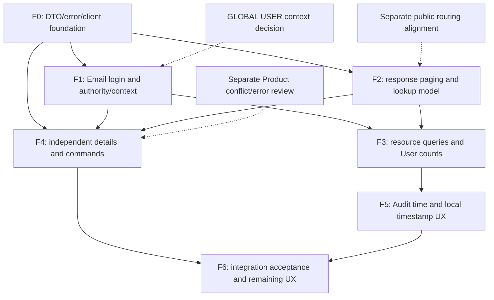

# Frontend/backend integration delta — review gate

Date: 2026-10-12. **AUDIT ONLY; implementation NOT AUTHORIZED.** Backend commit `939c7373552d676822d0f9d0fe92798fa8618100` (`feat(backend): complete accepted domain, identity and query refactors`) is the audited HEAD. Accepted backend M1–9/I1/corrections remain CLOSED. Phase A/B frontend behavior remains accepted history; current integration is pending.

## 1. Executive summary

The current frontend cannot be considered integrated with the committed backend. Its GLOBAL login/admin credential payloads use a removed field; Users consumers expect the removed array response; unauthorized Tenant collection requests run throughout the Shell; several pagers miscalculate the new default size. Asset associations no longer match rendered field names. These are confirmed static contract blockers, not new authorization privileges or reasons to restore old backend APIs.

Coverage: **77 business/auth/admin HTTP method-route pairs**, **22 named frontend consumers/shared interaction boundaries**, plus API/type/localization helpers and relevant tests. There are **27 confirmed frontend integration deltas (D01–D27)**, **two separately gated backend dependencies/inconsistencies (D28–D29)** and **one planning-document inconsistency (D30)**. These are unique findings, not endpoint counts. Three unresolved decision/verification items U1–U3 are listed separately. Static confirmation does not claim runtime reproduction or manual business-data evidence.

First recommended gate: F0 shared transport/projection/error foundation only, with an independently reviewed acceptance checkpoint before F1a GLOBAL Email login. No backend changes, UI implementation or test changes were made by this audit.

## 2. Baseline and authority

The backend source, migrations, tests and OpenAPI are byte-identical to the committed backend at audit start (`git diff HEAD -- backend docs/api/openapi.yaml` empty). Frontend and several documentation/deployment files are already dirty/untracked; those exact current files, not the older committed frontend, were inspected. A pre-audit SHA-256 inventory/status was captured in ignored `.cache/frontend-integration-audit/`; final comparison restricts this task's changes to this report and the existing repair plan.

Authority order: executable controllers/DTO binding, application authorization, query/SQL/writer behavior and tests establish actual API behavior; ARCHITECTURE, DOMAIN, AUTHENTICATION and COLLECTION_QUERY_IMPLEMENTATION_PLAN explain the approved target. The accepted 773-test backend result is historical verification evidence, not a new run here. The backend architecture audit, cross-module audit, lock-order correction and UI_IDENTITY_AND_RENDERING_STABILITY report provide dated evidence. Original frontend repair verification stays historical.

Source notation used below: **P** = `frontend/src/features/inventory/pages.tsx`; **S** = `frontend/src/app/Shell.tsx`; **A** = `frontend/src/auth.ts`; **B** = `backend/src/main/java/com/github/ksewen/kelios/`. Controller/DTO names below live in `B/platform/security/`; service/query names identify their module. Line references refer to the current inspected files. Each finding's two matrix rows jointly define its requested contract, impact, dependency, minimal action and verification.

The 22 consumers are AuthSession, Authentication, OrganizationPicker, Shell, Navigation, Dashboard, Metric, Assets, Registration, AssetDetail, Management, Pick, Audit, TenantAdministration, UserAdministration, ProviderAdministration, PasswordChange, Rows, Pager, Command, useRead and SearchableCombobox. Supporting helpers in inventory.ts/i18n.ts and route/dialog/confirmation composition were also inspected.

## 3. Endpoint-to-screen delta matrix

All D entries are **CONFIRMED source findings**; severity measures integration impact, not backend exploit severity. Shared endpoint families below are expanded in the complete endpoint inventory in §4. Unless stated otherwise, backend authorizes ACTIVE identity; ADMIN commands independently authorize scope, scoped foreign/absent detail is non-disclosing, business failures use ProblemDetail/code, and auth/admin failures use ProblemDetail/status without code.

| ID / classification / severity | Resource / exact endpoint(s) | Actual backend contract and evidence | Frontend consumer / current assumption | Precise delta / impact |
|---|---|---|---|---|
| D01 CONTRACT-BLOCKER / BLOCKER | POST /api/v1/auth/local/login | AuthController:12,19; strict `{email,password}`, canonical case-insensitive GLOBAL credential, verified+ACTIVE; unknown login field400 | A:38–43 sends `{login,password}`; Authentication.tsx:25 Username/max64 | Valid Email login request rejected before authentication; label/type/length also obsolete |
| D02 CONTRACT-BLOCKER / BLOCKER | POST /api/v1/users/global; PUT /api/v1/users/{id}/local-credential | UserDtos:40–62; IdentityAdminController:19,23; strict email/displayName/password or email/password; GA only | P:172–175 create/reset sends login | Both supported admin credential flows rejected400; no compatibility login field exists |
| D03 CONTRACT-BLOCKER / BLOCKER | GET /api/v1/users | UserDtos:18,21,32; Page items/page/size/totalElements, default20; forced TA ordinary USER scope | P:172–175 `useRead<Row[]>`, `.find`, Rows receives response as array | Page is passed to array operations/table; screen cannot reliably render or refresh selection |
| D04 CONTRACT-BLOCKER / BLOCKER | GET /api/v1/users?q=&status=PENDING&tenantId=… | identity/auth/AuthenticationService.list; IdentityStore.list; authorized combined predicates/count | Dashboard.tsx:10–11 `.filter` on Users response and counts local rows | Runtime array assumption invalid; replacing with items alone still undercounts full scoped pending population |
| D05 CONTRACT-BLOCKER / HIGH | GET /api/v1/tenants | TenantOperations:16–18 GA list/create, TA own detail only; USER denied | S:23,43 and Dashboard.tsx:10 unconditionally fetch array for labels/context | TA and both USER scopes receive403 on ordinary pages; GLOBAL USER context selector depends on unavailable collection |
| D06 FRONTEND-INTEGRATION / HIGH | GET /api/v1/tenants/{id}; GET/POST /api/v1/tenants | TenantOperations; TenantReads scope; Item/Detail metadata; POST returns UUID string | S:20,38 grants Tenant nav to all GLOBAL, none TA; P:167–169 opens Tenant dashboard from list | GLOBAL USER exposed unusable admin route; TA lacks mandated own-detail nav; no independent Tenant detail page |
| D07 FRONTEND-INTEGRATION / HIGH | GET/PUT /api/v1/tenants/{id}/oidc | OidcConfigurationService.administrativeTenant:43–53; GA or signed-own TA ADMIN; foreign404 | S:20,39 gates OIDC to GA only | Authorized TA singleton management unavailable; must not add Tenant switching/collection access |
| D08 FRONTEND-INTEGRATION / HIGH | DELETE /api/v1/tenants/{id}/oidc?version=N | IdentityAdminController:26; OidcConfigurationDtos:17–19; physical current-version DELETE; 200 empty, repeated404, stale409, atomic audit | P:177–181 has GET/PUT only, initialized flag/version form | No delete/recreate workflow; future deletion must clear secret/version/draft without treating disabled as deleted |
| D09 FRONTEND-INTEGRATION / HIGH | GET /api/v1/assets; GET /api/v1/tenants/{tenant}/assets; GET /api/v1/assets/{id} | AssetDtos:29–37 Item/Detail nested tenant/category/manufacturer/product/location/owner `{id,name}`; IDs/metadata remain | P:109,116–117 and Dashboard.tsx:11 read tenantName/productName/locationName/categoryName/manufacturerName/ownerName | Names render empty/undefined although safe readable projections exist; UUID identity is still aligned |
| D10 FRONTEND-INTEGRATION / HIGH | Catalog/Place lists; GET /api/v1/audit-log; GET /api/v1/assets/{id}/events | Resource DTO defaults20; Page authoritative size/count; beyond end empty/current metadata | P:62–63 Pager default25; P:113,145,153,165 omit size and ignore response.size | Next disabled too early, e.g. total21/default20; response-aware paging needed, not client slicing |
| D11 FRONTEND-INTEGRATION / MEDIUM | All ordinary pageable collection GETs | Resource DTOs0/20/max100; approved UI choices10/20/30/40/50/100 | inventory.ts:12 fixed25 for Assets; P pagers no selector | Missing approved page-size controls; Assets25 is valid explicit request but obsolete product default |
| D12 FRONTEND-INTEGRATION / MEDIUM | GET /api/v1/catalog/{categories|manufacturers}; GET /api/v1/tenants/{tenant}/catalog/{categories|manufacturers} | CatalogLabelDtos.query:42 onward, CatalogLabelQuery; q name, visibility exact; name/visibility sort+direction, defaultcreatedAt DESC | P:145,153 Name q only, unsortable headers | Supported server visibility/order controls missing; do not sort loaded rows or send createdAt as selectable label sort |
| D13 FRONTEND-INTEGRATION / MEDIUM | GET /api/v1/catalog/products; GET /api/v1/tenants/{tenant}/catalog/products | ProductDtos:31–39; q name OR number, visibility, categoryId/manufacturerId UUID, number literal substring; name/number/visibility sorts | P:145–153 q only, no reference/number/visibility controls or sorting | Missing approved Product criteria; retain backend substring semantics and reference IDs |
| D14 FRONTEND-INTEGRATION / MEDIUM | GET /api/v1/tenants/{tenant}/{locations|owners} | PlaceDtos:25–30; name q/name sort, fixed Tenant, note NOT query field | P Management q only | Missing supported Name order; never add note filtering/sorting |
| D15 FRONTEND-INTEGRATION / MEDIUM | GET /api/v1/assets; GET /api/v1/tenants/{tenant}/assets | AssetDtos:15–23; q four identifiers, loanable/loaned/state/reference UUID and dedicated identifier filters; wire sort `tag`,createdAt,lifecycle,condition | P:103–109 three state/loaned filters + raw reference-ID inputs | loanable/dedicated identifier criteria absent; reference filters lack readable selector; four existing sort requests are aligned |
| D16 FRONTEND-INTEGRATION / MEDIUM | GET /api/v1/audit-log | AuditDtos:10–17; exactaction/targetType/targetId/actorId, optional inclusive from/until UTC-offset, GAtenantId/globalOnly; occurredAt direction independently allowed | P:160–165 omits actor/time/order and size; current exact filters exist | Missing approved investigation controls; do not add q or username search |
| D17 FRONTEND-INTEGRATION / MEDIUM | Audit time bounds; POST /api/v1/assets/{id}/loan; all timestamp projections | AuditDtos:17, AssetDtos.Loan; absolute instants; DOMAIN local display/input, inclusive optional bounds | i18n.ts:39 forces UTC display; P:124–127 loan field asks raw UTC ISO | Display/input target mismatch; need client-local conversion, inclusive local calendar-day behavior; existing raw UTC input can submit valid API value |
| D18 FRONTEND-INTEGRATION / HIGH | GET /api/v1/catalog/{categories|manufacturers|products}/{id}; GET /api/v1/{locations|owners|users}/{id} | CatalogController:23,61,93; PlaceController:15,20; IdentityAdminController:18; independently scoped richer detail | P:146,153–154,172–175 selects loaded list row; reload only searches current page | No resource-ID detail reconstruction; missing detail-only fields and stale/out-of-page edit initialization; direct URL/refresh unsupported |
| D19 FRONTEND-INTEGRATION / HIGH | POST /api/v1/tenants/{tenant}/{locations|owners}; PUT /api/v1/{locations|owners}/{id} | PlaceDtos.Command:19–24 `{name,note}`; omission clears note; detail contains note, list omits it; Owner reference guard applies to all edits | P:147,150–154 sends name only and has no note/detail read | Renaming existing Location/unreferenced Owner can erase stored note; note create/edit/read missing |
| D20 FRONTEND-INTEGRATION / MEDIUM | Reference GET Catalog/Place candidates | Existing APIs accept bounded pages; approved picker target batch20/incremental append, no size selector | P:75 fixed25/replacement; SearchableCombobox.tsx:47–50 Previous/Next25 | Accepted old picker interaction must migrate deliberately to approved20 continuation; existing immediate search/UUID safety stays |
| D21 FRONTEND-INTEGRATION / HIGH | Detail associations + reference candidate GETs | ProductDtos:41–49, AssetDtos:29–37 provide ID+readable name; no implicit name→UUID resolution | P:76–77 fallback to selected UUID if absent first page; candidate detail shows Tenant UUID | Existing edit reference may appear as UUID despite known safe detail label; distinguish duplicate names with readable scoped context and short ID |
| D22 FRONTEND-INTEGRATION / MEDIUM | q on Catalog/Places/Assets/Users; Product manufacturerNumber filter | Query records trim/blank→none, literal escaped substring ≤128 UTF16 units; backend400 authoritative | P:59 NameFilter and SearchableCombobox.tsx:31 input lack maxLength; queries use raw pending comparison | Overlong requests avoidably fail; semantically equal trimmed applied values may refetch; normalize without filtering locally |
| D23 FRONTEND-INTEGRATION / MEDIUM | PUT /api/v1/auth/local/password; GLOBAL create/reset | identity/auth/Passwords:22–29 code-point12–128 uppercase/lowercase/digit/nonalphanumeric; backend independent | P Field:19–20 no policy validation; locales/en.json and de.json:140 say15–128 | Incorrect feedback and missing visible create/change policy checks; no frontend hashing or TENANT local credentials |
| D24 FRONTEND-INTEGRATION / HIGH | All auth/admin errors, especially OIDCversion/UserEmail conflicts | AuthProblems:15–29 ProblemDetail without machine code;400/401/403/404/409/429 carry status | A:90–92 defaultsREQUEST_FAILED; P:49–50/90 collapses status for presentation | Identity validation/denied/missing/conflict/throttle become indistinguishable; status retained on ApiFailure but dropped by Command |
| D25 FRONTEND-INTEGRATION / HIGH | Product PUT/publish; Assetcommands; DELETE Catalog/Places; Merge | BusinessProblems:11–20 codes include freeze/reference/deleted/constraint/concurrent/stale, distinct domain409s | P:90–91 generic error+draftHelp/reload for every failure; selected reload uses list; i18n.ts:42 maps code only | Generic409 cannot mean retry/latest Asset version; distinguish guards vs reviewable stale state vs uncertain transport, preserve current failed form session |
| D26 FRONTEND-INTEGRATION / MEDIUM | Safe metadata and associated Tenant fields across detail resources | Resource DTO Metadata server-owned actors/UTC, system label when applicable; User safe GlobalAccount/emailVerifiedAt detail | P/S use loose Row unknown, list modals omit metadata and account projection | Missing safe detail/account presentation and weak types conceal breakage; not all metadata needs mandatory visible columns |
| D27 FRONTEND-INTEGRATION / HIGH | Frontend auth/admin/resource fixture consumers | Actual DTOs, authority and status codes above; accepted backend tests verify them | auth.test.ts:12, inventory.test.ts:7, tests/ui-helpers.ts:5–8; browser fixtures users[],size25,flat*Name and USERtenants | Existing mocks can pass while real API fails; response/status/authority fixture revision is a prerequisite, not weaker assertions |
| D28 BACKEND-GAP / MEDIUM | PUT /api/v1/catalog/products/{id}; POST /api/v1/catalog/products/{id}/publish | catalog/CatalogService.lockProduct throws ObjectOptimisticLockingFailureException(Product.class); BusinessProblems:13 maps any other optimistic class to STALE_ASSET_VERSION | i18n.ts/error map correctly describes that code as an Asset version conflict | Confirmed error-contract inconsistency: reference conflict uses Asset-specific code/detail. No mutation/security correction authorized; narrowly review mapper/API test separately |
| D29 BACKEND-GAP / MEDIUM | GET /api/v1/auth/oidc/organizations | AuthController:27–28 default25; OidcConfigurationService:23–30 literal q without trim; approved publiclookup target20/normalization separately pending | A:97–103 and OrganizationPicker.tsx:14–36 also25/replacement | Current wire pair aligned, approved target incomplete on both sides; do not pretend frontend-only change fixes backend normalization |
| D30 DOCUMENTATION-ONLY / LOW | Repair-plan backend backlog/status | Committed plan records M1–9/I1 and corrections closed,773 passed | FRONTEND_UX_AND_FUNCTIONAL_DEFECTS still calls backend query gaps OPEN | Narrow plan cross-reference/status correction in this task; preserve historical Phase B closure and390px defect |

### Minimal alignment, dependencies and acceptance per finding

| ID | Dependency / minimal alignment action | Required tests and observable acceptance |
|---|---|---|
| D01 | F0 → F1a; Email input and strict email-only body | Mixed-case Email login; exact payload; no login field; token storage unchanged |
| D02 | F0/F1; Email create/reset initialized from safe detail | Exact payloads, GA-only commands, password boundaries, failed input retention, success/discard clearing |
| D03 | F0 → F2; render Page.items with returned metadata | More than three pages, no array-method errors, forced TA scope, no secrets |
| D04 | F2; server status=PENDING and authorized Tenant narrowing | Total count above20; mixed statuses/Tenants; never count only loaded rows |
| D05 | F1; restrict /tenants to GA; TA own detail; ordinary users no admin fetch | Full scope/role/status request matrix, no403 banners on business pages; U1 resolved before reader selector changes |
| D06 | F1/F4; direct Tenant detail and capability navigation | Direct URL/refresh, own/foreign/missing reads; no TA list or switching; existing sidebar geometry and semantic identity retained |
| D07 | F1; TA singleton route uses signed Tenant | Own TA GET/PUT; foreign denial; GA concrete context; role/status transition discards unavailable state |
| D08 | F1/F4; versioned DELETE with final destructive confirmation | Cancel sends zero requests; stale409 preserves input; success clears version/secret/group state; missing404; recreation requires fresh secret |
| D09 | F0; explicit reference projections display name | Actual Item/Detail fixtures, nullable Product/Owner, duplicate labels, stable IDs and no N+1 |
| D10 | F2; response-aware pager | total21,size20 permits Next; beyond-end remains empty; filter/sort/size/page transitions use server metadata |
| D11 | F2; six approved choices and default20 | Each size changes request and resets page0; applied criteria retained; no dropdown size selector |
| D12 | F2/F3; closed label criteria and supported headers | Combined q/visibility/order/page request; pending filters excluded from sorting/paging; default ordering omitted; no selectable createdAt |
| D13 | F3; Product criteria with reference IDs | Conjunctive filters; q searches name/number; dedicated number substring; no joined-name sorting |
| D14 | F3; Name ordering only | sort=name/direction; reset page0; no note query; fixed authorized Tenant |
| D15 | F3; supported Asset criteria and readable reference controls | Preserve sort=tag; applied combined predicates; pending edits send no request; no new unsupported sorts |
| D16 | F3/F5; actor UUID, optional UTC bounds and time direction | Independent inclusive bounds; explicit offset; microsecond precision; exact combined criteria; TA never sends GA scope fields |
| D17 | F5; client-local display/input conversion | DST23/25-hour days; local day becomes inclusive UTC range; optional boundaries; valid loan Instant; stored timestamps unchanged |
| D18 | F0/F4; independently fetched ID detail | Direct entry and refresh work without list membership; foreign404 matches missing; authoritative reopen versus retained failed session input |
| D19 | F4; load detail and replace name/note deliberately | Rename preserves note; explicit clear; referenced Location edit succeeds; all referenced Owner edits fail; note never searched |
| D20 | F2 picker subgate; append bounded20 batches | Additional results, bounded continuation, stable existing option nodes, stale query pages rejected, no Filter/size controls, keyboard/mobile |
| D21 | F0/F4 detail + F2 picker; authoritative selected label snapshot | Selection outside current page remains readable and keeps UUID; duplicate context; typing clears old selection; names never identity |
| D22 | F2; practical128 maximum and boundary normalization | Whitespace means no query; literal percent/underscore/backslash; backend validation retained; filters never trigger business dirty guard |
| D23 | F1; visible12–128 composition feedback | Password boundaries/composition in both locales; do not trim password; failure retains session; discard clears secrets |
| D24 | F0; preserve status and optional code with safe operation-aware fallback | Actual code-less400/403/404/409/429 and coded business errors; no invented backend codes or unsafe raw details |
| D25 | F0/F4; distinguish domain guard, stale state and uncertain outcome | Frozen/referenced cannot suggest blind retry; detail reload retains current failed inputs; no automatic mutation replay |
| D26 | F0/F4; endpoint DTOs and readonly detail metadata/account projections | No secret exposure or metadata overposting; system actor recognized; only authorized Email command writes account Email |
| D27 | Fixture revision within each phase, not weaker assertions | Page/projection/201/204 fixtures; denied USER admin, TA own singleton; preserve existing DOM/focus/form assertions |
| D28 | Separate backend error-contract approval | HTTP test for Product reference conflict; neutral/resource-correct feedback and rollback; no backend implementation in frontend gate |
| D29 | Separate narrow public-lookup contract gate before coordinated target rollout | Omitted size20 and normalized literal search; only enabled minimal routes; frontend bounded append; no authority inference |
| D30 | This documentation task | Backend closed; frontend, lookup,390px, delivery/export future gates remain open |

## 4. Aligned endpoint groups and complete coverage

These endpoints were inspected even when no new payload mismatch exists. ALIGNED means static wire/authority behavior for the stated portion, not complete UI acceptance.

- Auth CSRF GET, session refresh POST, session DELETE and me GET: A:29–69,113–119 match AuthController:17,23–25. Same-origin cookies, no-store, timeouts, access in memory, coordinated refresh and logout generation protection are retained. Own password PUT uses currentPassword/newPassword and CSRF plus Bearer correctly; D23 concerns the policy UI.
- OIDC routing lookup GET → explicit OrganizationPicker routingId selection → POST /auth/oidc/{tenant}/start → HTTPS authorizationUrl navigation → backend callback GET →303 /auth/complete or /auth/failed → refresh: Authentication:16–20,25, A:97–112 and AuthController:27–38. There is no anonymous /tenants lookup or frontend interpretation of provider claims. Current batch25 behavior matches executable code; D29 records the approved target gap.
- Category and Manufacturer create (root and Tenant routes), edit, delete, publish, preview and Merge: Management P:147–156 still sends valid name/sourceId/targetId bodies. Merge/publication are GA-only, with no Product/Place Merge. HTTP201{id} and204 empty responses are accepted by A:94–95. Preview remains quiet and in the same dialog; pair changes invalidate old preview; execution confirmation Cancel sends no mutation. Detail and query gaps are D12/D18/D26.
- Product POST/PUT name/categoryId/manufacturerId/manufacturerNumber, DELETE and publication remain aligned apart from detail/query/feedback gaps. Blank number becomes null; no Merge exists. The permanent historical edit freeze is an intentional guard requiring appropriate feedback, not permission relaxation.
- Place POST/PUT/DELETE routes and name remain valid, but omitted PUTnote clears existing data (D19). Owner guards cannot be bypassed by note-only edits; referenced Location remains editable and retained references prohibit deletion.
- Asset explicit commands P:98–127 match AssetController:17–26 and AssetDtos:40 onward: Product ID alone or direct Catalog IDs, required Location/loanable, optional Owner, text replacement, expectedVersion, Catalog/loanability/Location/Owner reassignment, lifecycle target/reason/note, condition target with optional note omitted, loan borrower/optional UTC return/loanNote, and return expectedVersion. No arbitrary PATCH or Asset DELETE exists. History retains flat actor/type/data/occurredAt; D09/D10/D17/D21/D25 identify integration gaps.
- User approval/role/disable bodies and no-op disable confirmation match the explicit commands; TA ordinary USER restrictions and self-protection remain authoritative. Tenant POSTname/unpaged GA items match; missing detail navigation is D06. OIDC PUT matches issuer/clientId/clientSecret/enabled/version/allowedGroupIds. Initial null version requires a secret; later null secret retains/re-encrypts. Secret is write-only and success clears the local field. Initial GET404 is handled. TA access, DELETE and feedback require D07/D08/D24.
- Audit current exact action/targetType/targetId/GA context filters and independent detail GET are aligned. There is no live actor lookup, username search or raw claims. Tenants intentionally remain unpaged and configuration remains a singleton.

### Audited method-route inventory (77)

Routes use `/api/v1`. Controller line inventory follows; named wildcard families in the matrix represent these concrete routes, not speculative endpoints. Health/branding/static endpoints are outside this backend business integration count; bootstrap/recovery CLI is infrastructure, not a browser endpoint.

```text
GET /api/v1/tenants/{tenant}/assets backend/src/main/java/com/github/ksewen/kelios/platform/security/AssetController.java 13
GET /api/v1/assets backend/src/main/java/com/github/ksewen/kelios/platform/security/AssetController.java 14
GET /api/v1/assets/{id} backend/src/main/java/com/github/ksewen/kelios/platform/security/AssetController.java 15
GET /api/v1/assets/{id}/events backend/src/main/java/com/github/ksewen/kelios/platform/security/AssetController.java 16
POST /api/v1/tenants/{tenant}/assets backend/src/main/java/com/github/ksewen/kelios/platform/security/AssetController.java 17
PUT /api/v1/assets/{id}/metadata backend/src/main/java/com/github/ksewen/kelios/platform/security/AssetController.java 18
PUT /api/v1/assets/{id}/catalog backend/src/main/java/com/github/ksewen/kelios/platform/security/AssetController.java 19
PUT /api/v1/assets/{id}/loanability backend/src/main/java/com/github/ksewen/kelios/platform/security/AssetController.java 20
POST /api/v1/assets/{id}/lifecycle-transitions backend/src/main/java/com/github/ksewen/kelios/platform/security/AssetController.java 21
POST /api/v1/assets/{id}/condition-transitions backend/src/main/java/com/github/ksewen/kelios/platform/security/AssetController.java 22
PUT /api/v1/assets/{id}/location backend/src/main/java/com/github/ksewen/kelios/platform/security/AssetController.java 23
PUT /api/v1/assets/{id}/owner backend/src/main/java/com/github/ksewen/kelios/platform/security/AssetController.java 24
POST /api/v1/assets/{id}/loan backend/src/main/java/com/github/ksewen/kelios/platform/security/AssetController.java 25
POST /api/v1/assets/{id}/return backend/src/main/java/com/github/ksewen/kelios/platform/security/AssetController.java 26
GET /api/v1/audit-log/{id} backend/src/main/java/com/github/ksewen/kelios/platform/security/AuditController.java 10
GET /api/v1/auth/csrf backend/src/main/java/com/github/ksewen/kelios/platform/security/AuthController.java 17
POST /api/v1/auth/local/login backend/src/main/java/com/github/ksewen/kelios/platform/security/AuthController.java 19
POST /api/v1/auth/session/refresh backend/src/main/java/com/github/ksewen/kelios/platform/security/AuthController.java 23
DELETE /api/v1/auth/session backend/src/main/java/com/github/ksewen/kelios/platform/security/AuthController.java 24
GET /api/v1/auth/me backend/src/main/java/com/github/ksewen/kelios/platform/security/AuthController.java 25
PUT /api/v1/auth/local/password backend/src/main/java/com/github/ksewen/kelios/platform/security/AuthController.java 26
GET /api/v1/auth/oidc/organizations backend/src/main/java/com/github/ksewen/kelios/platform/security/AuthController.java 27
POST /api/v1/auth/oidc/{tenant}/start backend/src/main/java/com/github/ksewen/kelios/platform/security/AuthController.java 29
GET /api/v1/auth/oidc/{tenant}/callback backend/src/main/java/com/github/ksewen/kelios/platform/security/AuthController.java 30
GET /api/v1/catalog/categories backend/src/main/java/com/github/ksewen/kelios/platform/security/CatalogController.java 15
GET /api/v1/tenants/{tenant}/catalog/categories backend/src/main/java/com/github/ksewen/kelios/platform/security/CatalogController.java 19
GET /api/v1/catalog/categories/{id} backend/src/main/java/com/github/ksewen/kelios/platform/security/CatalogController.java 23
POST /api/v1/catalog/categories backend/src/main/java/com/github/ksewen/kelios/platform/security/CatalogController.java 25
POST /api/v1/tenants/{tenant}/catalog/categories backend/src/main/java/com/github/ksewen/kelios/platform/security/CatalogController.java 27
PUT /api/v1/catalog/categories/{id} backend/src/main/java/com/github/ksewen/kelios/platform/security/CatalogController.java 33
DELETE /api/v1/catalog/categories/{id} backend/src/main/java/com/github/ksewen/kelios/platform/security/CatalogController.java 37
POST /api/v1/catalog/categories/{id}/publish backend/src/main/java/com/github/ksewen/kelios/platform/security/CatalogController.java 41
POST /api/v1/catalog/categories/merge-preview backend/src/main/java/com/github/ksewen/kelios/platform/security/CatalogController.java 45
POST /api/v1/catalog/categories/merge backend/src/main/java/com/github/ksewen/kelios/platform/security/CatalogController.java 49
GET /api/v1/catalog/manufacturers backend/src/main/java/com/github/ksewen/kelios/platform/security/CatalogController.java 53
GET /api/v1/tenants/{tenant}/catalog/manufacturers backend/src/main/java/com/github/ksewen/kelios/platform/security/CatalogController.java 57
GET /api/v1/catalog/manufacturers/{id} backend/src/main/java/com/github/ksewen/kelios/platform/security/CatalogController.java 61
POST /api/v1/catalog/manufacturers backend/src/main/java/com/github/ksewen/kelios/platform/security/CatalogController.java 63
POST /api/v1/tenants/{tenant}/catalog/manufacturers backend/src/main/java/com/github/ksewen/kelios/platform/security/CatalogController.java 65
PUT /api/v1/catalog/manufacturers/{id} backend/src/main/java/com/github/ksewen/kelios/platform/security/CatalogController.java 71
DELETE /api/v1/catalog/manufacturers/{id} backend/src/main/java/com/github/ksewen/kelios/platform/security/CatalogController.java 75
POST /api/v1/catalog/manufacturers/{id}/publish backend/src/main/java/com/github/ksewen/kelios/platform/security/CatalogController.java 79
POST /api/v1/catalog/manufacturers/merge-preview backend/src/main/java/com/github/ksewen/kelios/platform/security/CatalogController.java 83
POST /api/v1/catalog/manufacturers/merge backend/src/main/java/com/github/ksewen/kelios/platform/security/CatalogController.java 87
GET /api/v1/catalog/products backend/src/main/java/com/github/ksewen/kelios/platform/security/CatalogController.java 91
GET /api/v1/tenants/{tenant}/catalog/products backend/src/main/java/com/github/ksewen/kelios/platform/security/CatalogController.java 92
GET /api/v1/catalog/products/{id} backend/src/main/java/com/github/ksewen/kelios/platform/security/CatalogController.java 93
POST /api/v1/catalog/products backend/src/main/java/com/github/ksewen/kelios/platform/security/CatalogController.java 94
POST /api/v1/tenants/{tenant}/catalog/products backend/src/main/java/com/github/ksewen/kelios/platform/security/CatalogController.java 95
PUT /api/v1/catalog/products/{id} backend/src/main/java/com/github/ksewen/kelios/platform/security/CatalogController.java 97
DELETE /api/v1/catalog/products/{id} backend/src/main/java/com/github/ksewen/kelios/platform/security/CatalogController.java 98
POST /api/v1/catalog/products/{id}/publish backend/src/main/java/com/github/ksewen/kelios/platform/security/CatalogController.java 99
GET /api/v1/tenants backend/src/main/java/com/github/ksewen/kelios/platform/security/IdentityAdminController.java 14
GET /api/v1/tenants/{id} backend/src/main/java/com/github/ksewen/kelios/platform/security/IdentityAdminController.java 15
POST /api/v1/tenants backend/src/main/java/com/github/ksewen/kelios/platform/security/IdentityAdminController.java 16
GET /api/v1/users backend/src/main/java/com/github/ksewen/kelios/platform/security/IdentityAdminController.java 17
GET /api/v1/users/{id} backend/src/main/java/com/github/ksewen/kelios/platform/security/IdentityAdminController.java 18
POST /api/v1/users/global backend/src/main/java/com/github/ksewen/kelios/platform/security/IdentityAdminController.java 19
POST /api/v1/users/{id}/approve backend/src/main/java/com/github/ksewen/kelios/platform/security/IdentityAdminController.java 20
PUT /api/v1/users/{id}/role backend/src/main/java/com/github/ksewen/kelios/platform/security/IdentityAdminController.java 21
POST /api/v1/users/{id}/disable backend/src/main/java/com/github/ksewen/kelios/platform/security/IdentityAdminController.java 22
PUT /api/v1/users/{id}/local-credential backend/src/main/java/com/github/ksewen/kelios/platform/security/IdentityAdminController.java 23
PUT /api/v1/users/{id}/email backend/src/main/java/com/github/ksewen/kelios/platform/security/IdentityAdminController.java 24
GET /api/v1/tenants/{id}/oidc backend/src/main/java/com/github/ksewen/kelios/platform/security/IdentityAdminController.java 25
DELETE /api/v1/tenants/{id}/oidc backend/src/main/java/com/github/ksewen/kelios/platform/security/IdentityAdminController.java 26
PUT /api/v1/tenants/{id}/oidc backend/src/main/java/com/github/ksewen/kelios/platform/security/IdentityAdminController.java 27
GET /api/v1/tenants/{tenant}/locations backend/src/main/java/com/github/ksewen/kelios/platform/security/PlaceController.java 13
POST /api/v1/tenants/{tenant}/locations backend/src/main/java/com/github/ksewen/kelios/platform/security/PlaceController.java 14
GET /api/v1/locations/{id} backend/src/main/java/com/github/ksewen/kelios/platform/security/PlaceController.java 15
PUT /api/v1/locations/{id} backend/src/main/java/com/github/ksewen/kelios/platform/security/PlaceController.java 16
DELETE /api/v1/locations/{id} backend/src/main/java/com/github/ksewen/kelios/platform/security/PlaceController.java 17
GET /api/v1/tenants/{tenant}/owners backend/src/main/java/com/github/ksewen/kelios/platform/security/PlaceController.java 18
POST /api/v1/tenants/{tenant}/owners backend/src/main/java/com/github/ksewen/kelios/platform/security/PlaceController.java 19
GET /api/v1/owners/{id} backend/src/main/java/com/github/ksewen/kelios/platform/security/PlaceController.java 20
PUT /api/v1/owners/{id} backend/src/main/java/com/github/ksewen/kelios/platform/security/PlaceController.java 21
DELETE /api/v1/owners/{id} backend/src/main/java/com/github/ksewen/kelios/platform/security/PlaceController.java 22
GET /api/v1/audit-log backend/src/main/java/com/github/ksewen/kelios/platform/security/AuditController.java 9
```

## 5. Authentication and identity findings

The actual identity key is exact verified `(issuer, subject)` in `B/identity/auth/OidcProvisioning.java:23–32` and V4 external_identity PRIMARY KEY. Tenant routingId is a locator for the singleton configuration, not a new identity key. Different issuers with identical subjects or readable names remain distinct; changing a display name does not merge accounts. The same issuer/subject is one mapped identity, and a mapping cannot be reused for another Tenant. No multi-Tenant membership or universal Provider collection exists. A different client/configuration for the same issuer is not itself a new provider identity key.

The frontend selects an explicitly offered routingId before starting unknown-provider login. A known `/login/tenant/{routingId}` route is an approved explicit routing shortcut, not implicit authorization inferred from Tenant membership. Retain both paths. Do not invent a Provider UUID or send email/username/displayName as external identity. Backend validates current enabled configuration, groups, issuer/client/version/protocol and final mapping; a legitimate recreated configuration may accept an earlier valid flow. The frontend handles redirect completion by refreshing cookies; it does not validate OIDC claims itself. Real IServ interoperability remains separately pending.

GLOBAL local identity is Email; no dual login compatibility exists. Email comparison is case-insensitive, account detail exposes only safe Email/verification time, and admin-created/bootstrap/reset/edited identities are manually verified at this stage. ACTIVE reflects approved normal status; GLOBAL issuance also requires verified usable credentials. No delivery/token verification infrastructure is needed in frontend alignment. TENANT stays OIDC-only.

Session transport is substantially ALIGNED: no localStorage tokens; HttpOnly refresh; CSRF for cookie-authenticated mutations; shared refresh promise; logout generation; no replay of failed mutations. AuthSession.install validates scope consistency but accepts non-UUID test IDs and does not validate User id at runtime; stronger boundary validation belongs to F0, not a new backend rule. Access-token role/status snapshots expire naturally; no immediate revocation is promised. Refresh updates the in-memory identity, and useRead includes role/status/Tenant in its validity boundary. Do not add provider polling to refresh or logout revocation as incidental integration work.

## 6. Authorization and context findings

| Principal | User admin | Tenant admin | Configuration | Audit | Business context |
|---|---|---|---|---|---|
| ACTIVE GLOBAL ADMIN | Approved full admin | Unpaged list/create/detail | Concrete authorized Tenant singleton | Aggregate or supported narrowing | Global or concrete resource context, never a new identity |
| ACTIVE TENANT ADMIN | Own signed Tenant ordinary USER population | Own UUID detail only; no collection | Own signed singleton CRUD | Captured own Tenant records | Signed Tenant only |
| ACTIVE GLOBAL USER | Denied | Denied | Denied | Denied | Approved business reads; no Tenant collection as discovery |
| ACTIVE TENANT USER | Denied | Denied | Denied | Denied | Signed own Tenant business reads |
| PENDING/DISABLED | Denied | Denied | Denied | Denied | No business access; PENDING minimal status session, DISABLED refresh denied |

Backend sources: `Authorization`, `TenantOperations`, `AuthenticationService.list/detail/managed commands`, `OidcConfigurationService.administrativeTenant`, `InventoryOperations.audit`. Frontend Shell is reached only for ACTIVE identity (Authentication:24); role-only checks there are not themselves an ACTIVE bypass. Nevertheless nav/reads wrongly use GLOBAL rather than GA for Tenant and GA rather than ADMIN-own scope for provider management. Remove that obsolete coupling, not backend protections. A caller's path/query/body Tenant can never widen signed authority. Concrete-Tenant creation and Catalog visibility rules remain correct; no permission broadening is proposed.

Future route and control changes must independently handle403/404 as well as visibility. Out-of-scope UUID knowledge is not authority. TA Tenant navigation opens its own detail and TA configuration uses signed Tenant without collection discovery/switching. Preserve accepted Sidebar grouping, sizing, logo/Home, keyboard/collapse identity and Global terminology while changing capability destinations only under the approved integration gate.

## 7. Collection query findings

| Resource | Executable request contract | Frontend status |
|---|---|---|
| Category/Manufacturer | page/size/q/visibility/sort/direction; sort=name or visibility; default createdAt DESC | Name explicit apply exists; visibility/sorting/20 pager missing |
| Product | above plus categoryId/manufacturerId/manufacturerNumber; q name OR number; sort=name/number/visibility | q works server-side; additional criteria/sorts missing |
| Location/Owner | page/size/q/sort=name/direction, path Tenant service-derived | q works; note excluded; Name order missing |
| Assets | page/size/q; lifecycle/condition,loaned/loanable, five reference UUIDs, three dedicated identifier substrings; sort=tag/createdAt/lifecycle/condition | Existing server header sorting ALIGNED; filters partly missing; fixed25; nested projection mismatch |
| Users | Page with displayName q; scope/role/status/authorized tenantId, sort=displayName/scope/role/status | Old array consumer; no pager, query or sort controls |
| Audit | Page, exact action/targetType/targetId/actorId; GA tenantId OR globalOnly, optional inclusive from/until, sort=occurredAt/direction | Exact old criteria aligned; actor/time/order/pager missing |
| History | Owning Asset page/size only; fixed occurredAt DESC | Correct history semantics; pager assumes wrong size |
| Tenants | GA list unpaged; no q/page/sort parameters | Array still appropriate for GA; other principals must not fetch it |
| Configuration | Tenant singleton, no collection | No artificial collection needed |
| Anonymous routing | page/size/q, current default25, enabled configs only, names ordered readably | Current wire aligned; approved20/normalization and incremental target separately pending |

All ordinary page endpoints default0/20/max100 and return requested page/size/totalElements/items; beyond-end remains empty, not redirected. Max100 does not prohibit bounded metric sizes1/5 or an explicit25 request; the six sizes are the ordinary list UI choices, not the complete accepted backend integer range. Catalog/Place/User direction without selectable sort is invalid; Asset/Audit direction has a resource default. Do not apply a universal query serializer that sends unsupported sort=createdAt, q on Audit, tenantId on path-only criteria, deleted or unpaged flags everywhere.

Backend reads authorize then filter the full collection, order and paginate. Existing SQL UUID ties in some resources are allowed implementation details, not a new mandatory Domain rule. Audit timeline has no mandated UUID tie. Frontend TanStack Rows currently renders the supplied response order with no local sorting; preserve that. No required collection capability is still missing from the accepted backend sequence except the explicitly pending public-routing lookup alignment. Users pagination and Asset sorting must not be incorrectly described as absent backend features.

Explicit Apply and separate pending/applied state exist in Management/Assets/Audit. Preserve that distinction and reset page only on applied changes/order/size. Immediate entity lookup is different. Shell departure remount currently resets list state, with Assets intentionally seeded from Dashboard URL criteria; do not introduce saved business drafts or persistence of previous page queries during unification. Clarify any approved deep-link filter initialization without inventing cross-departure persistence.

## 8. Domain mutations, detail and projections

Actual create responses vary: Catalog/Places201{id}, Tenant200 UUID string, User200 state, Asset200 state. Existing AuthSession.request accepts any successful2xx,204 and200 empty body; client behavior is aligned. Browser helpers asserting every mutation200 are not. Catalog/Place mutation requests exclude actor/metadata. Asset returns flat IDs/state plus nested associations on read, not a uniform metadata object for every endpoint. Do not build a universal entity mapper or patch all JSON fields back to the server.

Place editing is particularly urgent: detail includes note but list omits it, and omitted PUTnote clears it. Loading the authoritative detail before edit protects existing data; adding a field initialized from a list cannot. Referenced Location remains editable; referenced Owner rejects all edits, including note-only changes. The backend supplies no generic canEdit bit or historical usage count in every detail; hide actions only where supported facts exist and always present backend guard failures clearly.

Product ordinary edit freezes permanently after historical registration; delete depends on retained current reference. Concurrent Merge can invalidate prelocked Product references and produce an optimistic conflict. Merge remains advisory preview plus freshly validated execution, never a lock/token. Approved Category/Manufacturer Merge preview blockers and response fields remain compatible. Do not add Product/Owner/Location Merge, Asset deletion, User deletion/reactivation, Tenant edit/delete or provider reset/restore.

Independent detail GETs exist for all eight entity-like resources; only Asset and Audit currently reconstruct independent detail in the frontend. Tenant dashboard is not Tenant resource detail. Detail DTOs can be richer than Item DTOs; selected ID/label state must not require list row retention. Association ID/name projections avoid unnecessary label lookup requests and supply correct readable values; labels cannot identify records. Metadata and safe account projection must remain readonly except explicit allowed commands.

## 9. Error contract and feedback

BusinessProblems normally provides status/detail/code; AuthProblems deliberately currently provides status/detail without code. Security filter errors may also lack the business code. AuthSession keeps HTTPstatus but turns absent code into REQUEST_FAILED and discards detail; Command then retains only code. Do not infer the actual underlying cause from a fictional code. A status-aware sanitized operation fallback can improve identity feedback without backend changes; finer machine classification needs a separately approved backend error-contract gate.

A HTTP409 can mean stale Asset version, changed Product reference snapshot, retained-reference prohibition, permanent Product freeze, invalid publication visibility, duplicate Email, OIDCversion conflict, concurrent identity operation or integrity constraint. Do not put all of them behind automatic retry or “reload Asset version.” Transport timeout can represent unknown mutation outcome; a pre-submit confirmation Cancel represents no dispatch and no warning. B.4 no-op behavior already works and must remain.

D28 is a concrete code/documentation semantic mismatch: `CatalogService.lockProduct` now throws an optimistic Product exception, while `BusinessProblems.stale` maps it to STALE_ASSET_VERSION. Existing backend lock tests prove transaction outcomes but do not assert that HTTP code for the Product race. This audit does not repair it, reopen the accepted locking algorithm or authorize backend work. The smallest independent follow-up is resource-correct conflict mapping plus focused HTTP regression. Temporary frontend handling, if approved, should describe the failing operation rather than assert a nonexistent Asset version change.

## 10. Rendering and asynchronous invariants

- Keep semantic component/input/navigation/option identity across same-context query/result/locale/sidebar changes. UUID keys remain; translated labels/random/revision remount keys do not.
- useRead P:25–54 currently retains valid data across ordinary query refresh and rejects old effects/session/resource changes. It scopes resource to path plus Tenant/global query identity; new scoped query controls must retain that boundary. Current request flags disable invalidated picker options.
- Incremental lookup needs separate validity for query/context and continuation page: old pages cannot append to a new query; duplicate IDs must not recreate existing options. Selected UUID/label is independent of currently loaded pages. Normal refetch retains selection; typing explicitly enters new search and clears the old UUID.
- Shell:43 currently keys the resource view by identity/context/path, deliberately ending the prior resource/form session. Query updates within a page do not use that key. Do not expand keys to sort/page/locale revisions or replace every read with a spinner.
- B.2 form write sessions are ephemeral after success/confirmed discard, not persisted drafts. A rejected discard or failed submission keeps the same mounted session and input. New Email/note/delete/detail forms must reset controlled state and secret fields deliberately, without remount reset tricks.
- ConfirmationProvider/discardWrites and Command already coordinate Cancel/X/Escape/navigation; nested combobox Escape closes the popup first. Preserve focus return, pointer versus keyboard focus, no-op final confirmation cancellation and preview freshness. Ordinary refresh text stays quiet.
- List filters are presentation state and never business dirty state. Table scroll, active row selection and focus remain stable during valid background responses; authorization/session/Tenant changes discard inaccessible state. Re-render identity tests must accompany each implementation slice, not be deferred until all changes land.

## 11. Existing tests and gaps

| Existing coverage | What it genuinely supports | Revision/addition required |
|---|---|---|
| auth.test.ts:10–65 | CSRF/memory access, refresh coordination, pending/disabled handling, logout races, non-replayed mutations, explicit HTTPSstart | Assert email-only body and254 bound; real code-less ProblemDetail status handling; unique identity UUIDs across distinct issuer fixtures without guessing names |
| inventory.test.ts:4–10 | Product-only reference payload, nullable conventions, state graphs/history snapshots | Replace fixed25 assertion with response-aware standard paging; typed query/projection checks |
| tests/collection-query.spec.ts | Assets header changes request; pending criteria excluded; stale ordering guarded | Preserve sort=tag wire, add sizes20/six choices and real nested associations; no current-page sort |
| list-filtering/search-stability/merge-combobox suites | Explicit list Apply versus direct lookup, stale responses, focus/DOM identity, duplicate UUID labels, Merge preview/no-op/X behavior | Current Page shapes/default20, incremental20 continuation, selected label outside page; preserve all stable identity/focus assertions |
| form-lifecycle/dialog-toolbar | Success/discard resets, rejected discard and failed same session, confirmation Cancel no warning, concise labels/focus | GLOBAL Email payload/account fixtures; note/detail authoritative reopen; OIDCdelete/recreate; no hidden field erasure |
| sidebar-layout | Accepted collapse widths/axis/identity, logo Home, locales/mobile architecture | Capability nav for TA own Tenant/configuration and denied USER administration; geometry and logo contract unchanged |
| inventory.spec.ts:41,49,53 | Some real write tests and fixture Tenant/context isolation | Users[] and USERtenant-list fixtures are obsolete; payloadlogin and flat association assumptions obsolete; exact201/204 expectations |
| authentication.spec.ts; ui-helpers.ts:5–13; phase4-localization.spec.ts | Old runtime auth/credential/UI paths and translation checks | Email environment credentials and current labels/API, supported context model; never execute persistent write tests on manual environment during audit |
| Backend resource/PostgreSQL tests | Accepted scope, projections, guards, counts, current OIDC and transaction semantics | Use representative actual fixtures; UI intercepts do not prove backendSQL. Product HTTP error mapping gap belongs to separate gate |

`frontend/playwright.config.ts:5` excludes authentication.spec.ts and inventory.spec.ts unless KELIOS_TEST_TLS=true. They were not run or counted in this audit. Their intercepted sections are excluded with the containing file in default configuration too. Other historical/browser mocks returning users[], always allowing /tenants, size25 despite omitted request size, or flat*Name hide real integration faults. Existing tests are evidence of their fixture interactions, not proof of the new backend contract. No frontend/backend suites were rerun merely to get green output from stale fixtures.

Future tests must include own/foreign/missing detail, all role/status combinations, GA context changes, TA no switching, authorization change on refresh, stale request after logout/context change, paged counts above20, beyond-end metadata, optional association nulls, read-only system attribution, local-timeDST, and mutation failures distinct from pre-submit Cancel. Mocking different display names is not enough to prove issuer/subject identity separation; use isolated protocol/backend evidence and browser session UUIDs without client identity matching.

## 12. Implementation dependency graph



Regression coverage runs within every slice. It is not a late optional phase. Assets remain the server-sorting baseline rather than a parity rewrite. Domain mutation and query work can be reviewed per resource once shared authority/types are ready.

## 13. Proposed implementation phases — all require separate approval

| Gate | Scope / files | Prerequisites and required behavior | Tests / human acceptance | Explicit exclusions |
|---|---|---|---|---|
| F0 | auth.ts, inventory.ts, i18n/error helpers and focused unit fixtures; small endpoint-owned types if needed | No implicit array/universal DTO; Page/projections/status+optionalcode; preserve empty2xx and non-replay | Actual backend DTO fixtures, invalid responses, identity/admin code-less errors and business codes; no generic unsafe detail display | Backend error rewrite, broad UI refactor, universal mapper/framework |
| F1a | Authentication.tsx/auth.ts/locales/auth tests | F0; GLOBAL Email login and12–128 feedback; provider/session unchanged | Exact Email payload, valid/invalid login, CSRF/logout/pending/status; keyboard/locales | Email delivery, provider username semantics, dual login |
| F1b | Shell capability destinations/context reads, Dashboard, Tenant/configuration access | F0/F1a; remove /tenants coupling for USER/TA; TA own detail/configuration; U1 decision for reader context | Role/status request matrix, foreign404, no accidental requests; sidebar/brand/Global/focus geometry unchanged | Tenant switching, provider collection, permission widening, Phase A redesign |
| F2 | Pager/query model, Assets/Management/Audit/history consumers, Pick/SearchableCombobox, User Page consumer | F0; response-aware0/20/100, six list sizes, pending/applied separation, bounded20 append candidates | Page21 boundary, all sizes, counts, late results, focus/scroll/options/selection; publiclookup rollout depends D29 | Client filtering/sorting, unpaged browser bypass, giant query framework |
| F3 | Resource-specific table criteria/header controls, Users/Dashboard counts | F1/F2; label/Product/Place/Asset/User supported query fields only | Request parameters, full server response order, applied/pending sort/page semantics, totals; review resource slices independently | New backend sorts/filters, note search, arbitrary display-name→ID |
| F4 | ID detail routes/projections; note/UserEmail/OIDCdelete/resource forms and feedback | F0/F1/F2; authoritative detail initializes new sessions; preserve active failed values; account/note guards | Direct URL/refresh, note preservation, Email create/reset/edit, scoped commands, versionedDELETE, no-op Cancel, conflict reload/atomic-outcome fixtures | Asset/User/Tenant deletion, generic PATCH, owner-note exception, provider reset; D28 backend repair separately approved |
| F5 | Audit controls/local-time presentation and loan time inputs | F0/F3; actor UUID, optional inclusive bounds/direction, local→UTC | UTCoffset/microsecond validation, DST calendar-day semantics, exact combined requests and denied GA narrowing forTA | Username/Phase D schema, history query expansion, timezone storage rewrite |
| F6 | Focused complete integration acceptance; separately approved residual table UX | Prior slices; Chromium DE/EN1440/1024/768/390, accepted rendering/form/preview contracts | Representative current-API read-only runtime plus isolated write fixtures; real-data limitations explicit; resource-sized review | Seed/operator writes, deployment/reset without approval, automatically closing390px defect, export/Email/Phase C |

F0/F1a can be reviewed first and independently. F2 basic User Page decoding should unblock admin views before F3 query extensions. F4 note preservation should precede offering edit on note-bearing resources. Resource-scoped subsets of F3/F4 can be accepted independently; a monolithic frontend rewrite is not required.

## 14. Open decisions, unresolved evidence and acceptance gates

- **U1 PRODUCT-DECISION:** GLOBAL USER cannot list Tenants or read administrative Tenant detail, yet current UI uses the GA collection for resource context selection/name discovery. Backend still authorizes its business reads; no new discovery endpoint is approved. Human must decide the minimal allowed reader context-entry/presentation UX or separately approve a safe business-context projection. Do not restore USER /tenants or use anonymous provider routing as post-login authority. TA/USER signed Tenant requires no switching decision.
- **U2 PRODUCT-DECISION:** exact frontend URLs/route-backed detail composition for the seven non-Asset entity detail capabilities need review. Their API IDs/details are already defined; this is a frontend navigation decision, not an unresolved backend CRUD lifecycle. Preserve established Asset/detail routes and API names.
- **U3 UNVERIFIED evidence:** static analysis establishes the mismatches; no current-backend browser/manual interoperability or physical assistive-technology session was executed. New incremental/list/detail responsive geometry and local-time behavior need actual future rendered verification. Existing browser-only intercepted tests cannot prove live compatibility. No manual Asset business dataset or real IServ callback success is claimed.

D28 is a confirmed semantic error-mapping inconsistency, not UNVERIFIED transaction behavior. D29 is the existing explicitly pending backend lookup target, not a regression requiring all closed modules to reopen. Remaining Tenant edit/delete, User deletion/reactivation, provider restore/reset, delivery/export and username semantics stay outside this integration plan.

Acceptance sequence: human accepts this audit and U1/U2 decisions where relevant; separately authorizes the first F0 slice; requires current API fixtures and preserved A/B regressions; reviews each subsequent resource/phase. No gate starts automatically. Optional table cosmetics and the known390px Product-name limitation remain FRONTEND-UX, not contract blockers or backend creation repairs. Phase C and D are not started by this audit or its plan.

## 15. Audit verification and preservation

Read-only inspection covered the controller inventories, DTOs/query records, signed-scope services, authentication/provisioning, error advice, safe projections and representative backend/security tests, current OpenAPI and current normative/evidence documents. Frontend API clients, router/Shell, collection/detail/form/confirmation/picker consumers, localization and unit/browser fixture assumptions were traced. No application suite or runtime environment was invoked; the accepted773-pass result remains accurately historical.

Only this report and the narrow repair-plan integration/status references were edited. Final SHA-256 comparison against the pre-audit inventory verifies all other tracked/untracked files unchanged. `git diff --check`, separate new-document whitespace/conflict checks and relative link checks passed. The index remains empty; no staging, commit, push, PR, dependencies, test data, schema, deployment, reset or operator-data change. Pre-existing unrelated work remains intentionally dirty/untracked; exact final status is captured in `.cache/frontend-integration-audit/final-status.txt`.

**Recommendation: authorize F0 only as the first implementation checkpoint.** Do not bundle login forms, U1 context policy, query/table work, backend error/lookup changes or later gates into that first slice. STOP for human acceptance of this audit.
