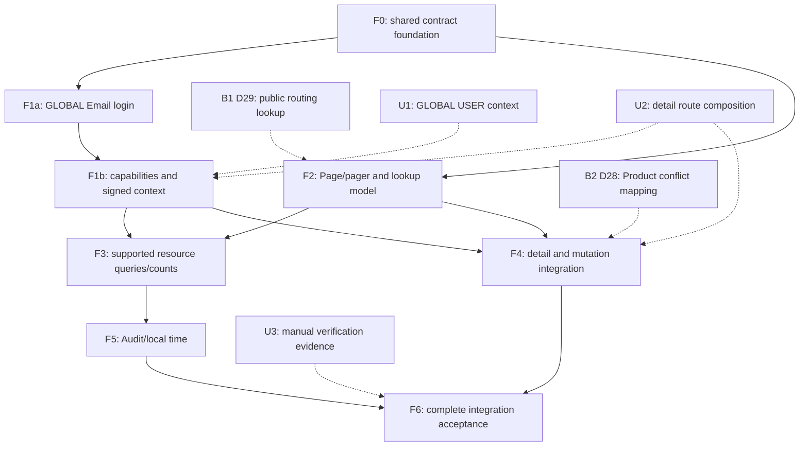

# Frontend/backend integration execution plan

**Planning status: HUMAN ACCEPTED as the authoritative execution plan, 2026-10-12. F0/D24 are HUMAN ACCEPTED / CLOSED as of 2026-10-12. F1a/D01 are HUMAN ACCEPTED / CLOSED as of 2026-10-12; F1b D05–D07 HUMAN ACCEPTED / CLOSED, 2026-10-12; F2 business scope HUMAN ACCEPTED / CLOSED, 2026-10-12; F3/D04/D12–D15 HUMAN ACCEPTED / CLOSED, acceptance date 2026-10-12; F4 unblocked scope HUMAN ACCEPTED / CLOSED, 2026-10-13; F5 HUMAN ACCEPTED / CLOSED, 2026-10-13; F6/D27 combined integration and F6-A01 HUMAN ACCEPTED / CLOSED, 2026-10-13; documented U3/runtime/manual limitations explicitly accepted.**

**Current boundary: U1/U2 and Tenant read correction HUMAN ACCEPTED/RESOLVED / CLOSED, 2026-10-12. F0/F1a/F1b and F2 business scope are HUMAN ACCEPTED / CLOSED. F3/D04/D12–D15 HUMAN ACCEPTED / CLOSED, acceptance date 2026-10-12. B1/D29 anonymous routing subset BLOCKED / NOT AUTHORIZED; B2 NOT AUTHORIZED; F6/D27 combined integration and F6-A01 HUMAN ACCEPTED / CLOSED, 2026-10-13; documented U3/runtime/manual limitations explicitly accepted; F5/D16/D17 HUMAN ACCEPTED / CLOSED, acceptance date 2026-10-13; F4 unblocked scope HUMAN ACCEPTED / CLOSED, acceptance date 2026-10-13; exact Product conflict subset remains BLOCKED under B2/D28.**

## 1. Purpose and authority

Backend baseline: `939c7373552d676822d0f9d0fe92798fa8618100`, `feat(backend): complete accepted domain, identity and query refactors`. M1, Steps 2–9, I1, Step 7/8 corrections, cross-module audit and Catalog/Product/Merge lock-order correction remain HUMAN ACCEPTED / CLOSED. Committed baseline verification was 74 unit + 699 PostgreSQL integration = 773 passed; accepted U1 Tenant-read correction verification is 74 unit + 701 PostgreSQL integration = 775 passed, zero failures/errors/skips; this plan does not claim a new run.

The accepted [integration audit](../analysis/FRONTEND_BACKEND_INTEGRATION_DELTA.md) establishes D01–D30 and U1–U3. **This document owns frontend/backend integration execution.** The audit remains evidence/rationale, not a second execution plan. [The older repair plan](FRONTEND_UX_AND_FUNCTIONAL_DEFECTS.md) owns historical Phase A/B acceptance and separately gated C/D/390px UX work. [The backend plan](COLLECTION_QUERY_IMPLEMENTATION_PLAN.md) owns accepted backend completion and future backend/export/Email gates; it does not authorize frontend implementation.

Actual committed controllers/DTOs/services/query semantics/error advice/tests establish the executable API. [ARCHITECTURE](../../ARCHITECTURE.md), [DOMAIN](../../DOMAIN.md) and [AUTHENTICATION](../AUTHENTICATION.md) establish approved intent. If these disagree, record the difference and stop the affected slice for human decision; do not restore obsolete APIs, silently change authority, or reopen the whole backend program. Historical plans/ADRs/mocks cannot override current contracts.

Objective: integrate the existing accepted frontend with endpoint-specific current contracts while preserving accepted UI/session/form behavior. No new Domain lifecycle, generic framework, speculative backend query or permission widening is implied.

### Status vocabulary

- **PLANNED:** specified, not authorized; dependencies can still be pending.
- **BLOCKED:** specified but a human decision or separate backend contract prevents closing its affected subset. Unblocked subsets still need explicit authorization.
- **AUTHORIZED:** only an explicit human instruction may set this status and define the slice.
- **IMPLEMENTED / PENDING HUMAN ACCEPTANCE:** actual implementation and verification recorded; STOP.
- **HUMAN ACCEPTED / CLOSED:** only explicit human acceptance closes it. Closure never authorizes another gate.

Gate status and authorization are separate from dependency readiness. No candidate file listed below is permission to edit it during planning.

## 2. Global implementation invariants

Every gate must preserve:

1. Backend authorization and scoped non-disclosure are authoritative. ACTIVE ADMIN is required for administration. TA User administration is its signed Tenant ordinary USER population; TA Tenant access is own detail only. GLOBAL USER safe Tenant context discovery is human-required and distinct from administration; backend correction HUMAN ACCEPTED / CLOSED, 2026-10-12. TENANT USER does not consume Tenant collection. Tenant-owned writes require one concrete authorized Tenant.
2. UUIDs identify resources/references. Readable names are presentation and may be duplicated; no name-to-ID guessing. ID/name projections are endpoint-specific and safe. Actors/timestamps/ownership/deletion/audit fields remain server-owned.
3. External identity is exact verified issuer/subject, not Email, displayName, username or selected Tenant. Tenant supplies signed authority/context, not a substitute identity key or multi-membership. Keep explicit Provider routing selection when unknown, and existing known-routing shortcuts; no implicit authority from routing.
4. Stable semantic React nodes/keys across same-context requests, paging, response arrival, locale/sidebar changes. Preserve input focus, selection, table/page scroll and navigation identity. No random/revision/translated remount keys, blanket memoization or reset-by-remount.
5. Latest-response and session/resource/Tenant isolation. Ordinary valid reads may stay mounted; invalidated options cannot be selected. Old continuation pages cannot append to a new lookup query/context. UUID selection survives valid refresh/out-of-page results independently of query/label.
6. Ephemeral business write sessions. Failure/rejected discard continues the same mounted session. Confirmed discard/success ends it and explicitly clears controlled write/secret state. Every abandonment path uses the existing dirty policy; no saved drafts. Filters are presentation state, not unsaved business edits.
7. No mutation auto-replay after failure/timeout/conflict or unknown outcome. Pre-submit confirmation Cancel is a pure no-op with zero request/warning. Keep same-dialog quiet Merge preview and obsolete-pair rejection, fresh authoritative execution and consequential confirmation.
8. All collection filtering/sorting/paging is one server query. Pending versus applied state remains distinct. Typing in lists sends no request; Apply/Enter commits criteria. Sort/page use applied criteria only; changed applied criteria/order/size resets page0. No local-page sorting/filtering/slicing, client unpaged escape hatch, or ordinary deleted browser filter.
9. Ordinary list defaults0/20/max100 and six UI sizes10/20/30/40/50/100; use returned Page metadata. Resource-specific supported fields/direction rules only. Tenants intentionally unpaged, configuration singleton, owning-Asset history simple. Search/reference lookup stays immediate and bounded, eventually incremental20 without Filter/size selector.
10. No universal entity mapper, generalized fetching framework, reflective copying or speculative query DSL. Explicit endpoint-owned types and small reviewable helpers are allowed. Different response shapes must remain different.
11. No operator/manual data seeding, persistent test records, real destructive Merge, reset or deployment without separate authorization. Use intercepted/isolated fixtures for writes; operator supplies manual data. Secrets/claims/credentials must not leak through fixtures/evidence.
12. Phase A/B stays accepted: Sidebar/topbar widths/grouping/logo/Home/Global/mobile identity, concise actions, explicit list Apply, quiet refresh, focus accessibility and form semantics. Capability destinations may change only as explicitly owned below; no unrelated redesign. C/D, export, delivery, Tenant edit/delete, User deletion/reactivation, provider restore/reset and Asset deletion are excluded.

## 3. Dependency graph and execution order

Recommended review order: **F0 → F1a → F1b → F2 → F3 → F4 → F5 → F6**, one explicitly authorized slice at a time. F2 foundational paging may be independently reviewed after F0; it need not wait for unrelated U1 policy, provided it does not implement context discovery. F3 and F4 can be split per resource after their prerequisites. F5 needs F3 applied-query infrastructure but need not wait for unrelated Product commands. This is dependency discipline, not automatic serial authorization.

| Dependency | Kind and affected scope |
|---|---|
| F0 → later consumers | Hard: typed response/error foundations before consumers relying on them |
| F1a → F1b | Hard for live GLOBAL administrator login/access verification; fixtures can isolate F1b, but do not close live compatibility on old login |
| F1b/F2 → F3/F4 | Hard for administrative context and collection-dependent selectors/counts; resource slices may omit unrelated pending subsets only if human authorizes that boundary |
| F3 → F5 | Hard for combined applied criteria/order/page; local formatter helpers can be tested independently within F5 |
| U1 → F1b | Subset blocker: GLOBAL USER context discovery/selection/presentation only; removal of forbidden admin calls and signed TA behavior do not need a new discovery contract |
| U2 → F1b/F4 | Resolved prerequisite: approved canonical Tenant destination in F1b and seven detail routes/composition in F4; F1b accepted; F4 unblocked scope authorized |
| B1 → F2 | Subset blocker: closing anonymous OIDC routing lookup target20/normalized q; business reference APIs already support size20. No need to block basic pagers |
| B2 → F4 | Subset blocker: closing exact resource-correct Product optimistic HTTP feedback. Actual lock correction stays closed; other forms can integrate |
| U3 → F6 | Evidence requirement, not API/design blocker. Human may accept explicit manual limitations; never fabricate or seed data to close it |
| F4/F5 → F6 | Hard: completed authorized scope before complete integration acceptance. Any accepted partial closure must list unresolved subsets explicitly |

## 4. Gate execution contracts

All candidate paths below are repository-relative. References to `pages.tsx` mean `frontend/src/features/inventory/pages.tsx`. Existing audit §3 supplies exact source/endpoint evidence; the contracts here supply execution order and acceptance without reconstructing that audit.

### F0 — shared endpoint contracts and error/client foundation

**Status: HUMAN ACCEPTED / CLOSED, acceptance date 2026-10-12. F0 implementation and its unchanged limitations are recorded in [F0 evidence](../verification/FRONTEND_INTEGRATION_F0.md).**

- **Objective / owner:** D24. Establish typed endpoint DTO/Page/projection/error contracts needed by later findings without changing their screens now.
- **Dependencies:** accepted baseline/audit; no U1/U2/B1/B2 prerequisite. Confirm current worktree and preserve unrelated modifications.
- **Behavior:** endpoint-owned response/request types for current API; Page items/page/size/totalElements; association `{id,name}`; distinguish Item/Detail/State/Metadata/GlobalAccount, singleton/unpaged/timeline. Preserve HTTPstatus plus optional backendcode, safely handle code-less auth/admin ProblemDetail. Preserve200 empty/201JSON/204, CSRF/cookies/memory tokens, coordinated refresh/logout generations, one read refresh and no mutation replay. Error fallback may use status/operation; do not invent backend codes or surface unsafe raw detail. No universal shape cast.
- **Candidate files:** `frontend/src/auth.ts`, `frontend/src/inventory.ts`, `frontend/src/i18n.ts`, a small endpoint-owned type module if useful, existing auth/inventory unit tests; narrow `pages.tsx` useRead/Command error-value plumbing only if necessary to preserve status. Locales only for shared safe status fallback. No broad fetching abstraction.
- **Steps:** inventory consumed actual DTO shapes; add explicit types/mappings at boundaries; implement status+optionalcode handling without losing transport uncertainty; propagate structured failure through shared read/Command plumbing if required; replace representative test responses with current backend shapes; inspect shared callers for build compatibility without migrating F1–F5 behavior.
- **Tests:** focused auth/inventory/error units; real code-less400/403/404/409/429; coded business errors; successful empty bodies; exact memory/CSRF/logout/refresh behavior; no mutation replay; typed nullable associations and Page fixtures. Complete frontend unit suite mandatory for shared changes. Preserve existing browser request/session/error stability assertions with current fixtures where affected.
- **Runtime/browser:** focused intercepted Chromium shared/session/error consumers; no operator data. Live/current-backend verification is not necessary to claim only foundation completion; explicitly state whether performed.
- **Acceptance:** types reflect actual API without secret fields; Page/projections/error status survive; existing session/empty-success/non-replay behavior passes; production build and diff checks pass. D24 closes only when shared consumers no longer discard status required for safe fallback.
- **Non-goals:** **F1a Email login behavior, input labels/type/maxLength and login body changes are explicitly excluded**; no User screen conversion, pager controls, Asset rendering, detail routes, OIDC DELETE, backend machine-code changes, U1/U2 decisions or JSX redesign.
- **Stop:** missing contract, unexpected authorization dependency or need to generalize framework; record affected subset. After verification mark implemented/pending acceptance and STOP.
- **Evidence update:** this gate/status/owned finding; `docs/verification/FRONTEND_INTEGRATION_F0.md` with exact tests, changed files, boundary preservation and limitations.

### F1a — GLOBAL Email login

**Status: HUMAN ACCEPTED / CLOSED, acceptance date 2026-10-12; D01 only. [F1a evidence](../verification/FRONTEND_INTEGRATION_F1A.md) remains unchanged, including its explicit pending live-backend limitation.**

- **Objective / owner:** D01. Make the existing GLOBAL local login submit strict `{email,password}` and present Email.
- **Dependencies:** F0 accepted. Preserve explicit unknown-provider routing and all session mechanics.
- **Behavior:** Email entry with practical254 maximum and appropriate autocomplete/type; backend canonical case-insensitive comparison authoritative. No login/loginName field or dual mode. Do not trim passwords or apply password-creation composition as a login proof. PENDING/DISABLED handling remains; failed login does not imply an operation was dispatched successfully.
- **Files:** `frontend/src/Authentication.tsx`, `frontend/src/auth.ts`, DE/EN locales, auth unit tests, `frontend/tests/authentication.spec.ts`, `frontend/tests/ui-helpers.ts`, relevant localization/login browser fixtures only.
- **Steps:** change typed login client body; update Email UI/accessibility/localization and helpers; revise valid account fixtures; verify failed login feedback/current session cleanup; verify OIDC start/refresh/logout unchanged.
- **Tests:** exact Email payload/no old fields; mixed-case Email;254 versus overlong; sanitized invalid/denied/throttle; keyboard login; refresh restoration/expiry/logout and pending restricted screen; no TENANT local credentials. Complete units for auth changes.
- **Runtime/browser:** focused intercepted authentication; read-only live login/logout against current backend with operator-provided account where available. No bootstrap/create/reset/manual data. If current environment is not on audited backend, record that and request the separately authorized environment gate rather than deploy.
- **Acceptance:** Email login works against actual request contract; old login fields are never sent; DE/EN labels/accessibility match; session regressions/build/diff pass; live evidence accurately qualified.
- **Non-goals:** D02 admin Email create/reset/edit, password-creation policy D23, delivery/verification tokens, provider identity redesign, authority/navigation or collections.
- **Stop/evidence:** stop for external environment/credential dependency if live evidence required; update status/D01 and `docs/verification/FRONTEND_INTEGRATION_F1A.md`; human acceptance before next gate.

### F1b — administration capabilities and signed Tenant context

**Status: HUMAN ACCEPTED / CLOSED, acceptance date2026-10-12; D05–D07 only; U1/U2 and Tenant read correction accepted.**

- **Objective / owners:** D05,D06,D07. Align navigation/requests with current administration scopes without changing authority.
- **Dependencies:** F0/F1a accepted; separate Tenant backend-read approval/correction for GLOBAL USER selector; U2 canonical Tenant detail route resolved. Human may authorize a bounded TA/GA/no-forbidden-fetch subset first.
- **Behavior:** after separately approved backend correction, ACTIVE GLOBAL USER may fetch safe Tenant collection for the approved Global-first dropdown; GA administration list/create/detail remains independent; TA direct own signed detail with sidebar destination, never list/switching. USER administration denied; ordinary business reads remain. OIDC GA concrete Tenant or TA own singleton read/update routing is available; no USER access. Signed Tenant overrides transport context. Dashboard/Shell must not call forbidden Tenant collection for labels. Do not use anonymous provider routing as post-login discovery. Scope/role/status changes invalidate inaccessible data.
- **Files:** `frontend/src/app/Shell.tsx`, `frontend/src/app/Dashboard.tsx`, `pages.tsx` TenantAdministration/ProviderAdministration, endpoint types/locales, sidebar/context/search-stability/browser fixtures. Do not alter Sidebar dimensions/collapse/brand ownership.
- **Steps:** centralize only small capability predicates consistent with signed Identity; gate reads as well as visibility/routes; implement approved Tenant detail destination independently from list; enable own-TA configuration view; remove TENANT-principal collection coupling; preserve approved GLOBAL USER collection reads; implement U1 result only after decision; inspect role-refresh/context invalidation and direct URLs.
- **Tests:** complete scope/role/status request matrix; GA collection/create; TA own detail/foreign404/list absence; USER no sensitive administration requests (GLOBAL Tenant reads remain permitted); TA singleton only own; direct URL and refresh; refresh demotion removes capabilities; preserve semantic nav nodes/mobile focus/Global/geometry; no reader privilege widening.
- **Runtime/browser:** read-only current-backend GA and available TA/USER sessions; synthetic intercepted matrix for unavailable principals, clearly labeled; DE/EN representative desktop/mobile nav. No persistent users/Tenants/configuration writes for verification.
- **Acceptance:** no forbidden collection requests/banners on business pages; authorized own detail/configuration reachable; U1/U2 affected subsets explicitly resolved before full closure; request and UI guards agree without being backend proof.
- **Non-goals:** User collection/forms/counts conversion, physical DELETE UI, TENANT-principal switching, Tenant edit/delete, new discovery endpoint, frontend style redesign or backend policy change.
- **Stop/evidence:** do not replace approved U1 dropdown with workarounds or invent a different U2 route; record blocked subset. Update status/D05–D07/decision evidence and `docs/verification/FRONTEND_INTEGRATION_F1B.md`; STOP.

### F2 — response-aware paging and bounded lookup

**Status: HUMAN ACCEPTED / CLOSED, acceptance date 2026-10-12 — implemented business scope only. B1-dependent anonymous routing subset remains BLOCKED/NOT AUTHORIZED. [F2 evidence](../verification/FRONTEND_INTEGRATION_F2.md).**

- **Objective / owners:** D03,D10,D11,D20,D22. Decode User Page, correct all page boundaries/defaults and build the approved bounded lookup continuation.
- **Dependencies:** F0 accepted; F1b before administration/context-dependent consumers. Basic resource paging can be independently authorized after F0. B1 only for routing lookup target closure.
- **Behavior:** ordinary lists default0/20 and six choices10/20/30/40/50/100; requests carry applied query and size; response Page controls Next/Previous/count and beyond-end remains empty. History stays bounded/fixed ordering, no speculative history feature; use its actual size metadata. Users render items, not array, but Dashboard count semantics belong to F3. Query trim/blank normalization and practical128 input maximum; literal wildcards preserved. Lists remain explicit Apply; type-to-search reference pickers fetch20, append next batches at continuation boundary, no Filter/page-size selector and no uncontrolled infinite requests. Existing selections/labels/UUID nodes and pending safety survive.
- **Files:** `frontend/src/inventory.ts`, `pages.tsx` Pager/Management/Assets/Audit/AssetDetail/UserAdministration/Pick, `frontend/src/components/ui/searchable-combobox.tsx`, `frontend/src/auth.ts` organizations and `app/OrganizationPicker.tsx` only after B1; localizations; paging/filter/lookup unit/browser tests.
- **Steps:** remove fixed25 arithmetic/defaults in ordinary consumers; use returned page/size/count; implement small applied-query paging transitions; decode Users Page; keep pending filters separate; add lengths/normalization; model query-scoped continuation and deduplicated UUID append; coordinate anonymous lookup only after B1; retain initial/no-results/error/quiet refresh states.
- **Tests:** total21,size20 allows Next; all sizes change requests/reset page0; beyond-end metadata; applied filters/order survive page/size; pending edits do not leak; User Page >3pages; literal%/_/backslash; maxlength; appended UUID nodes/focus; stale continuation/context rejected; selected UUID survives refresh; keyboard/clear/duplicate names; no Filter/selector inside lookups. Complete units for shared changes.
- **Runtime/browser:** focused Chromium list/filter/search/combobox stability; responsive DE/EN1440/1024/768/390; read-only current backend lists where gate requires wire verification. Empty manual datasets do not prove multi-page behavior: fixtures must do so.
- **Acceptance:** no fake pagination/current-page manipulation; correct response boundaries/defaults/sizes; safe bounded20 business lookup append; no orphan stale options. Anonymous lookup subset cannot be marked closed while B1 unresolved.
- **Non-goals:** new query fields/header sorts, User count metrics, selected detail label integration D21, backend defaults/normalization changes or storing query state across departure.
- **Stop/evidence:** unsupported endpoint parameter/need for unpaged browser access/B1 dependency; update status/D03,D10,D11,D20,D22 and `docs/verification/FRONTEND_INTEGRATION_F2.md`; STOP.

### F3 — resource-specific applied queries and counts

**Status: HUMAN ACCEPTED / CLOSED, acceptance date 2026-10-12 — D04/D12–D15 only. [F3 evidence](../verification/FRONTEND_INTEGRATION_F3.md).**

- **Objective / owners:** D04,D12,D13,D14,D15. Surface already supported server queries and full scoped User counts.
- **Dependencies:** accepted F0/F1b/F2 for affected consumer. Resource-sized slices allowed; no blanket table rewrite.
- **Behavior:** Category/Manufacturer q name +visibility, name/visibility sort; Product q name OR manufacturerNumber +visibility/categoryId/manufacturerId/number literal substring, three sorts; Places name q/name sort only; Asset existing tag/createdAt/lifecycle/condition sorts plus supported loanable/identifier/reference criteria. Wire Asset sort is `tag`, not `assetTag`. Users approved displayName/scope/role/status/authorized narrowing and sorts integrate with Page; Dashboard pending count queries status=PENDING and uses scoped totalElements, not local page count. Default createdAt is omitted for resources where not selectable. Pending edits never apply on sort/page; all applied predicates form one request.
- **Files:** `pages.tsx` Management/Assets/UserAdministration/Rows, `frontend/src/app/Dashboard.tsx`, resource query types/helpers, locales and collection-query/list-filtering/browser tests.
- **Steps:** introduce resource-owned closed criteria; add only supported controls/header parameters; readable selectors submit IDs; preserve Apply; atomic reset page0 and order transitions; server count metric; inspect authorization-dependent controls and responsive layouts.
- **Tests:** every supported filter/sort/direction combination request; server response order preserved rather than client-sort; pending exclusion on sort/page; clearing Apply; one logical request; totals>20 / mixed statuses/Tenants; foreign references never expand authority; no note/derived-name sort; table/input identity and scroll.
- **Runtime/browser:** DE/EN four widths, read-only representative current backend resources; intercepted multi-page/duplicate-key/server-order fixtures; no fabricated manual Asset sorting evidence.
- **Acceptance:** supported capabilities available and honest, applied query/request/pager coherent, authorized counts correct, hidden actions no placeholders, rendering stability preserved.
- **Non-goals:** Audit actor/time criteria owned F5; backend query extensions; local-page sorting; unsupported note/history/association-name sort; fixing390px Product wrapping unless separately authorized.
- **Stop/evidence:** any missing backend capability or Domain ambiguity; update owners/status and resource-sized evidence under `docs/verification/FRONTEND_INTEGRATION_F3*.md`; STOP after authorized slice.

### F4 — independent resource detail and mutation integration

**Status: HUMAN ACCEPTED / CLOSED for explicitly authorized unblocked scope, acceptance date 2026-10-13. Exact Product optimistic-conflict subset remains BLOCKED under B2/D28 (NOT AUTHORIZED). [F4 evidence](../verification/FRONTEND_INTEGRATION_F4.md).**

- **Objective / owners:** D02,D08,D09,D18,D19,D21,D23,D25,D26. Complete detail/association/account/note/command integration with correct feedback and write lifecycle.
- **Dependencies:** F0/F1b/F2 accepted for affected resource; approved U2 routes/composition for non-Asset detail routing; B2 before exact Product optimistic-error closure. Earlier gates provide types/authorization/paging, not duplicate ownership of these findings.
- **Behavior:** detail pages fetch by persistent ID, independent of list state/direct URL/refresh. Render nested association names while retaining IDs; selected labels outside current picker pages come from safe authoritative detail. Item/Detail/State shapes remain distinct. Note loaded from Place detail before name/note replacement; rename preserves note, explicitclear null; referenced Location editable, referenced Owner entirely blocked. GLOBAL admin Email create/reset/edit uses Email-only DTOs/safe GlobalAccount; password feedback12–128/composition and backend validation; no TENANT credential. Provider DELETE currentversion final confirmation, physically absent after success, reset secret/groups/version/input, recreation initial PUT with fresh secret. Show readonly appropriate metadata/system actor and safe account values. Distinguish domain409 guards versus stale/reference conflict versus uncertain transport. Reload authoritative detail without erasing active failed input.
- **Files:** `pages.tsx` Management/AssetDetail/Tenant/User/ProviderAdministration/PasswordChange, Shell/route composition approved by U2, projection helpers/types/locales, detail/create/dirty/confirmation/combobox/error/browser tests.
- **Steps:** implement resource-sized independent detail reads/routes; adopt nested Asset/related references; seed selected ID/label separately; integrate Place note with guarded replacement; integrate Email administration/password policy; implement versioned singleton DELETE/recreate; structured operation-aware conflicts/reload; metadata readonly; review success/discard/error resets for each slice.
- **Tests:** direct ID entry/refresh outside list/current page; foreign/absent nondisclosure; nested/null associations/readable duplicates; selected UUID outside page/refetch; notes preserved/cleared and reference guards; Email uniqueness/edit/reset/create payloads; password boundaries/composition; secret non-exposure; DELETE Cancelzero, stale409, missing404, success reset/recreation with fresh secret; no mutation replay; frozen/retained/reference versus unknown outcomes; rejecteddiscard same DOM/input and failedform retention; creation/update metadata never overposted. Fixture response codes must be201/204/200 as actual endpoint.
- **Runtime/browser:** read-only current-backend detail/projection checks; all write/destructive paths through intercepted fixtures or separately approved isolated backend fixtures, never operator mutation. DE/EN four widths and keyboard/nested dialog focus. Live create/Merge/DELETE is not authorized merely for acceptance.
- **Acceptance:** all owned resource details independent/current, labels readable, note/Email/commands exact, no data erasure or privilege broadening, ephemeral sessions stable; U2/B2 affected work explicitly resolved before full closure.
- **Non-goals:** generic CRUD/PATCH, Product/Place Merge, Asset/User/Tenant deletion or reactivation, provider reset/tombstone/history, backend mapper change, Email delivery, Phase C creation diagnosis or Phase D username work.
- **Stop/evidence:** need for backend mutation change, invented lifecycle, unresolved B2 or Tenant read correction; record narrow blocked scope. Update owned finding/status and resource-specific `docs/verification/FRONTEND_INTEGRATION_F4*.md`; STOP.

### F5 — Audit investigation and local-time presentation

**Status: HUMAN ACCEPTED / CLOSED, acceptance date 2026-10-13, D16/D17 only, 2026-10-13. [F5 evidence](../verification/FRONTEND_INTEGRATION_F5.md).**

- **Objective / owners:** D16,D17. Audit actor/time/order controls and approved local timestamp/input semantics.
- **Dependencies:** F0/F1b/F2/F3 applied-query foundation accepted; F4 is not a dependency for unrelated formatter/Audit work. Loan input composition must preserve its existing command/session handling.
- **Behavior:** actor UUID, exact action/target/context criteria, independently optional inclusive from/until; only occurredAt order/direction. Convert local input to absolute UTC with explicit offset; compare absolute values. Date-only bounds cover intended whole local day, inclusive upper bound at supported microsecond precision. Display client-local time, never rewrite stored values. Loan expectedReturnAt remains optional Instant. History fixed timeline, no user-selected query expansion. Captured Tenant/actor snapshots remain authoritative; TA never sends GA narrowing/globalOnly.
- **Files:** `pages.tsx` Audit/AssetDetail loan controls, `frontend/src/i18n.ts` or small timestamp helper, locales; local-time unit tests, Audit filter/clock/loan/browser fixtures.
- **Steps:** isolate UTC/local conversion helpers; add typed applied Audit criteria and supported time header; apply all predicates together/reset page0; update display/input affordances; verify optional/reversed bounds and errors; preserve actor UUID/no username lookup.
- **Tests:** exact combined requests, no q, independent bounds, inclusiveUTC, microseconds/reversed validation, DST23/25-hour localdays and timezone formatting; applied/pending transitions, stale response rejection; loan null/valid Instant; history immutable display/source.
- **Runtime/browser:** read-only Audit/current backend where authorized; browser contexts/timezones and DE/EN widths; intercepted loan writes; no permanent read audits assumed.
- **Acceptance:** local display and UTC transport unambiguous; combined investigation criteria follow API exactly; correct scopes/paging/focus; no username semantics invented.
- **Non-goals:** Audit writer/schema/actor snapshots, live User joins, Phase D, history subsystem, backend time precision change, export/reporting.
- **Stop/evidence:** unsupported timestamp contract or date ambiguity; update D16/D17/status and `docs/verification/FRONTEND_INTEGRATION_F5.md`; STOP.

### F6 — integration acceptance and residual UX boundary

**Status: HUMAN ACCEPTED / CLOSED, 2026-10-13, for D27 and combined integration including the separately accepted F6-A01 correction; documented U3/runtime/manual limitations accepted as limitations, not fabricated coverage. [F6 evidence](../verification/FRONTEND_INTEGRATION_F6.md). B1/B2 excluded; U3/excluded-suite limits remain explicit.**

- **Objective / owner:** D27; consolidate truthful fixture/API/regression/manual evidence after accepted slices. Residual UX is a separately scoped subset, not automatic extra implementation.
- **Dependencies:** authorized scope of F1–F5 accepted; F0 accepted; U1/U2 and B1/B2 resolved for included subsets; U3 evidence register reviewed. D27 fixture corrections happen during earlier gates, but F6 owns overall coverage closure.
- **Behavior:** verify the combined frontend against the actual committed API, not stale users[]/flat*Name/alwaysauthorizedTenants/omittedsize25 mocks. Preserve all accepted node/focus/form/preview/context behavior. Record any incomplete subsets honestly.390px Product-name wrapping remains separate FRONTEND-UX unless explicitly authorized and proven fixed.
- **Files:** focused frontend unit/browser tests and integration evidence/status documents; implementation changes only if an explicitly authorized residual UX slice lists them. No test weakening for green results.
- **Steps:** audit fixtures/counts/exclusions from prior evidence; run combined affected suites and build; inspect current-backend read/login navigation; verify four widths/locales; document real-data/provider/assistive limits and authorization request matrix; obtain human acceptance.
- **Tests/runtime:** complete unit suite if shared changes occurred; focused Chromium auth/context/query/detail/forms/combobox/Merge/search/sidebar tests; routing regressions retained where appropriate; read-only live backend requests. Intercepted writes stay separate from real operator evidence. Do not enable persistent-data suites on manual environment to manufacture coverage.
- **Acceptance:** exact executed counts/no counting excluded tests; coherent requests/projections/errors/scopes, human-approved limitations, D27 current fixtures reviewed; all included gates accepted; backend remainsclosed and no unauthorized later work starts.
- **Non-goals:** deployments/resets, manual data seeding, real destructive Merge/DELETE, automatically closing C/D/390px, export/delivery or backend broad re-audit.
- **Stop/evidence:** any unsupported contract or discovered defect reported for separate approval; update D27/U3/status and `docs/verification/FRONTEND_INTEGRATION_F6.md`; STOP for human review, never automatically commit/deploy/start next.

## 5. D01–D30 ownership register

This register is the sole completion ownership map. Earlier gates supply prerequisites, not duplicate completion responsibility. Each implementation slice must update its row and evidence with the owning gate. “Cross-gate” means frontend integration relies on earlier foundations; it never implicitly authorizes backend changes.

| Finding | Classification | Sole owner | Prerequisites | Completion condition | Scope | Current status |
|---|---|---|---|---|---|---|
| D01 | CONTRACT-BLOCKER | F1a | F0 | Email-only login payload/UI and session compatibility verified | Frontend-only | HUMAN ACCEPTED / CLOSED, 2026-10-12; live limitation preserved |
| D02 | CONTRACT-BLOCKER | F4 | F0,F1b; safe User detail | Email create/reset exact bodies, authorized successful/reset/error semantics | Cross-gate frontend | HUMAN ACCEPTED / CLOSED, 2026-10-13 |
| D03 | CONTRACT-BLOCKER | F2 | F0; F1b administrative scope | User Page.items and returned pagination decode/render without array assumptions | Cross-gate frontend | HUMAN ACCEPTED / CLOSED, 2026-10-12; business scope only, anonymous routing unchanged |
| D04 | CONTRACT-BLOCKER | F3 | F0,F1b,F2 | Scoped PENDING server total, not count of loaded User items | Cross-gate frontend | HUMAN ACCEPTED / CLOSED, acceptance date 2026-10-12 |
| D05 | CONTRACT-BLOCKER | F1b | F0,F1a; U1 reader subset | Approved GA/GU Tenant reads consumed after separate backend correction; TA/TU collection coupling removed; administration UI independently guarded | Frontend-only + decision | HUMAN ACCEPTED / CLOSED, 2026-10-12; F1b evidence |
| D06 | FRONTEND-INTEGRATION | F1b | F0,F1a; U2 Tenant route | GA list/create/detail and TA direct own detail navigation; USER administration destinations denied, GLOBAL USER safe Tenant detail permitted | Frontend-only + decision | HUMAN ACCEPTED / CLOSED, 2026-10-12; F1b evidence |
| D07 | FRONTEND-INTEGRATION | F1b | F0,F1a | Signed-own TA singleton management reachable; no switching/discovery privilege | Frontend-only | HUMAN ACCEPTED / CLOSED, 2026-10-12; F1b evidence |
| D08 | FRONTEND-INTEGRATION | F4 | F0,F1b | Current-version physical DELETE/no-op Cancel/reset/missing/recreate UI verified | Cross-gate frontend | HUMAN ACCEPTED / CLOSED, 2026-10-13 |
| D09 | FRONTEND-INTEGRATION | F4 | F0 endpoint projection types | Asset/detail/list/Dashboard nested association names rendered safely; IDs retained | Cross-gate frontend | HUMAN ACCEPTED / CLOSED, 2026-10-13 |
| D10 | FRONTEND-INTEGRATION | F2 | F0 Page contract | All existing pagers use response metadata; total21/default20 boundary correct | Frontend-only | HUMAN ACCEPTED / CLOSED, 2026-10-12; business scope only, anonymous routing unchanged |
| D11 | FRONTEND-INTEGRATION | F2 | F0 | Ordinary list default20/six sizes alter server request and reset page0 | Frontend-only | HUMAN ACCEPTED / CLOSED, 2026-10-12; business scope only, anonymous routing unchanged |
| D12 | FRONTEND-INTEGRATION | F3 | F0,F2 | Category/Manufacturer combined name/visibility/supported sorts exposed | Frontend-only | HUMAN ACCEPTED / CLOSED, acceptance date 2026-10-12 |
| D13 | FRONTEND-INTEGRATION | F3 | F0,F2 | Product approved query criteria/order including authoritative ref IDs | Frontend-only | HUMAN ACCEPTED / CLOSED, acceptance date 2026-10-12 |
| D14 | FRONTEND-INTEGRATION | F3 | F0,F2 | Place Name server sorting only; no note query | Frontend-only | HUMAN ACCEPTED / CLOSED, acceptance date 2026-10-12 |
| D15 | FRONTEND-INTEGRATION | F3 | F0,F1b,F2 | Asset supported missing predicates/readable ID selectors; existing four sorts preserved | Cross-gate frontend | HUMAN ACCEPTED / CLOSED, acceptance date 2026-10-12 |
| D16 | FRONTEND-INTEGRATION | F5 | F0,F1b,F2,F3 | Audit actor/time/order combined query with optional inclusive UTC bounds | Cross-gate frontend | HUMAN ACCEPTED / CLOSED, 2026-10-13 |
| D17 | FRONTEND-INTEGRATION | F5 | F0; local-time helpers | Client-local display/input and inclusive local-day→UTC behavior verified | Frontend-only | HUMAN ACCEPTED / CLOSED, 2026-10-13 |
| D18 | FRONTEND-INTEGRATION | F4 | F0,F1b,F2,U2 | Non-Asset ID details reconstruct from endpoint, not retained list row | Frontend-only + decision | HUMAN ACCEPTED / CLOSED, 2026-10-13 |
| D19 | FRONTEND-INTEGRATION | F4 | F0; independent Place detail | Notes preserve on rename, explicit clear, reference guards and ephemeral session | Frontend-only | HUMAN ACCEPTED / CLOSED, 2026-10-13 |
| D20 | FRONTEND-INTEGRATION | F2 | F0; B1 only anonymous lookup target | Bounded20 append with stale/context/UUID safety, no lookup Filter/size selector | Cross-gate frontend/backend subset | HUMAN ACCEPTED / CLOSED business lookup; BLOCKED B1 anonymous subset |
| D21 | FRONTEND-INTEGRATION | F4 | F0,F2; detail projections | Readable authoritative selected label outside current page; ID independent | Cross-gate frontend | HUMAN ACCEPTED / CLOSED, 2026-10-13 |
| D22 | FRONTEND-INTEGRATION | F2 | F0 | Practical128 query bound/trim/literal behavior without local filtering | Frontend-only | HUMAN ACCEPTED / CLOSED, 2026-10-12; business scope only, anonymous routing unchanged |
| D23 | FRONTEND-INTEGRATION | F4 | F0; F1a accepted identity terminology | Password creation/change/reset policy12–128 and composition visibly/independently validated | Cross-gate frontend | HUMAN ACCEPTED / CLOSED, 2026-10-13 |
| D24 | FRONTEND-INTEGRATION | F0 | Accepted audit/current API | HTTPstatus and optionalcode retained through shared errors with safe fallback | Frontend-only | HUMAN ACCEPTED / CLOSED, 2026-10-12; F0 evidence |
| D25 | FRONTEND-INTEGRATION | F4 | F0; B2 exact Product feedback subset | Domain guards/stale/uncertain feedback distinguished; independent reload preserves active input | Cross-gate frontend/backend subset | Unblocked scope HUMAN ACCEPTED / CLOSED, 2026-10-13; exact Product feedback BLOCKED B2/D28 |
| D26 | FRONTEND-INTEGRATION | F4 | F0 types; signed detail authorization | Safe readonly metadata/account/detail projections available, no secrets/overposting | Cross-gate frontend | HUMAN ACCEPTED / CLOSED, 2026-10-13 |
| D27 | FRONTEND-INTEGRATION | F6 | Current fixture revisions within each earlier slice | Combined fixture/error/status/authorization/query regression coverage audited against real API | Cross-gate frontend verification | HUMAN ACCEPTED / CLOSED, 2026-10-13; F6-A01 accepted; documented U3/runtime/manual limitations explicitly accepted, excluded real-write debt remains separate |
| D28 | BACKEND-GAP | B2 | Separate human backend authorization | Resource-correct Product optimistic HTTP conflict mapping and focused regression | Backend-only | BLOCKED / NOT AUTHORIZED |
| D29 | BACKEND-GAP | B1 | Separate human backend authorization | Public routing default20/normalized literal q and focused regression | Backend-only | BLOCKED / NOT AUTHORIZED; anonymous subset remains open |
| D30 | DOCUMENTATION-ONLY | This plan consolidation | Accepted audit/closed backend | Older repair plan points here, backend completion accurate, remaining gates preserved | Documentation-only | HUMAN ACCEPTED / CLOSED with planning acceptance |

Ownership refinement: audit suggestions about shared types/projection/error foundations are prerequisites, not a mandate for F0 to migrate resource screens. D09/D26 adoption closes in F4; D24 foundation closes in F0. D23 creation/change feedback closes in F4, not F1a login. D27 revisions accompany each slice but overall fixture coverage closes in F6. These are execution responsibility assignments; no audit finding or approved contract is changed.

## 6. U1–U3 decision/evidence register

| Item / status | Exact decision or evidence required | Owner and affected closure | Prohibited assumption / resolution record |
|---|---|---|---|
| U1 — HUMAN RESOLVED / CLOSED, 2026-10-12 | GLOBAL USER initially Global; Tenant dropdown uses existing complete collection ID/name/metadata, optionally lazy loaded; UUID changes business context only | F1b/D05 dependency-ready with respect to U1; backend correction HUMAN ACCEPTED / CLOSED, 2026-10-12; F1b/D05–D07 HUMAN ACCEPTED / CLOSED, 2026-10-12 | Complete collection/detail projection and provenance disclosure approved. No reduced DTO/new endpoint. GU read-only; GA create unchanged; TA own detail/no list; TU unchanged. Other admin GETs unchanged. [Evidence](../verification/TENANT_GLOBAL_USER_READ_CORRECTION.md). |
| U2 — HUMAN RESOLVED / CLOSED, 2026-10-12 | Canonical /categories/{id}, /manufacturers/{id}, /products/{id}, /locations/{id}, /owners/{id}, /users/{id}, /tenants/{id}; preserve /inventory/assets/{id} | Tenant destination F1b accepted; other detail implementation F4 unblocked scope HUMAN ACCEPTED / CLOSED, 2026-10-13 | Independent UUID GET, not list/Row authority. Category/Manufacturer/Location/Owner route-backed modal from live list, standalone fallback; Product/User/Tenant standalone. Direct entry/refresh reconstructs independently. No contextual aliases for authority; Tenant detail does not switch context. [Resolved record](../analysis/FRONTEND_U1_U2_DECISION_PREPARATION.md#5-u2--human-resolved--closed-2026-10-12). |
| U3 — LIMITATIONS HUMAN ACCEPTED, 2026-10-13; unavailable manual/runtime evidence remains UNVERIFIED | Record what was actually exercised against current backend, real provider/operator datasets/assistive tech/browser matrix versus fixtures; decide accepted remaining limits | Evidence owner per gate; final F6 human acceptance. No redesign implied | No invented real Asset sort, IServ interoperability or physical assistive testing. Operator creates business data; empty datasets are valid disclosed limits. Lack of unavailable credentials/data never authorizes seeding/reset. Human may accept limitations explicitly. |

U2 is resolved; U1 HUMAN RESOLVED / CLOSED; backend correction HUMAN ACCEPTED / CLOSED, 2026-10-12. U3 is not an architecture/product-contract uncertainty and cannot be “resolved” by changing the API. Neither elapsed time nor this planning approval resolves a decision or grants implementation authorization.

## 7. Independent backend dependencies — no implementation authorization

### B1 — public OIDC routing lookup alignment (D29)

**Status: PLANNED, NOT AUTHORIZED.** Existing accepted backend program stays CLOSED; this is its explicitly remaining lookup target.

- **Exact gap:** AuthController organizations defaults25; OidcConfigurationService.organizations does not trim q. Approved lookup target is batch20/trim/all-whitespace→no text search, literal safely escaped case-insensitive lookup. It remains minimal enabled organization routing, not a provider/admin collection or identity grant.
- **Smallest expected backend scope:** narrow HTTP default and service normalization/validation reconciliation; DTO/OpenAPI/focused tests only as actually needed. No schema assumed, generic query infrastructure, Tenant authorization, credentials or provisioning change.
- **Focused regression:** omitted-size response20; zero-based/max bounds; normalized blank/literal wildcard and128 bound; enabled-only minimal projection; later page/full count; no secret/membership leak; explicit routing behavior unchanged. Appropriate isolated PostgreSQL/backend verification after separate authorization.
- **Frontend dependency/interim rule:** anonymous OrganizationPicker continuation target cannot close before backend alignment. F2 can integrate business size20 lookups and pagers independently. Until B1 is separately accepted, retain honest current wire behavior; do not silently claim backend normalization/default migrated, normalize server data locally, or interpret routing as authority. If separately authorized to request size20 explicitly before B1, record it as partial client alignment with server omission/normalization still pending.
- **Evidence/status:** independent backend verification document chosen on authorization; update B1/D29 and link it here. Stop for human acceptance, no automatic F2 rollout.

### B2 — Product optimistic conflict error mapping (D28)

**Status: BLOCKED / NOT AUTHORIZED.** Accepted Product/Merge lock algorithm and domain guards remain CLOSED.

- **Exact inconsistency:** CatalogService.lockProduct throws ObjectOptimisticLockingFailureException(Product.class) when prelocked reference snapshot changed. BusinessProblems.stale maps that to STALE_ASSET_VERSION with Asset-specific detail. This is a confirmed semantic error contract mismatch, not new deadlock/security evidence.
- **Smallest expected backend scope:** resource-correct or neutral optimistic-conflict mapping and focused HTTP regression, preserving HTTP409, transaction rollback and Asset version behavior. Reuse existing neutral conflict vocabulary where consistent with reviewed API; no new mapper/framework, retry or lock redesign.
- **Focused regression:** Product edit/publish reference race returns appropriate machinecode/detail; Asset version remains STALE_ASSET_VERSION; ProductSelection dependency-validation behavior remains appropriate; no successful mutation audit from aborted Product command. Isolated PostgreSQL HTTP tests plus affected/backend verification under separate approval.
- **Frontend dependency/interim rule:** F4 other forms remain implementable; exact Product conflict feedback cannot close while unresolved. Preserve409/actualcode, contextualize by failing resource and never say an Asset changed solely from a Product operation. An explicitly approved temporary resource-aware message may avoid wrong text, but must not fabricate a servercode or mark B2 closed. No auto-retry.
- **Evidence/status:** separate backend report after authorization; update B2/D28 and dependent F4 subset. Stop for human acceptance.

Neither B1 nor B2 is an implicit implementation step of an F gate. A new contradiction requiring another backend capability is reported to the human instead of added silently to these scopes.

## 8. Verification ladder and evidence policy

For every authorized slice:

1. Run focused frontend unit tests for changed contract/query/time/session behavior.
2. Run the complete frontend unit suite (`npm test` in frontend) when shared infrastructure changes; resource-only slices may run it too if justified. Do not count stale fixture green output as live integration.
3. Run focused Chromium suites (`npm run test:smoke -- <affected specs>`), including applicable auth/query/detail/form/combobox/Merge/search/sidebar identity coverage. Browser configuration excludes authentication.spec.ts and inventory.spec.ts unless KELIOS_TEST_TLS=true; state exclusion explicitly. Do not count excluded tests as passed/skipped. Do not enable suites that create persistent manual records merely to fill coverage.
4. Run frontend production build (`npm run build`).
5. Inspect actual delta versus pre-gate worktree and run `git diff --check`; separately check new untracked files. Preserve unrelated work, inspect generated/private material and do not stage/commit unless separately requested.
6. Perform live/current-backend verification only where the gate requires it, using existing operator accounts/data read-only. First verify the target actually matches the committed API; no deployment, bootstrap/reset or operator mutation is implied. Destructive/create paths use intercepted/isolated fixtures. Record absent data/provider/account constraints instead of inventing evidence.
7. Record exact commands, executed counts/failures/errors/skips, browser matrix, build/diff result and limitations; obtain human acceptance.

All implementation gates need DE/EN changed-string checks and keyboard behavior. Four-width1440/1024/768/390 rendering is required for gates changing controls/layout; infrastructure-only F0 does not claim a visual migration. Focus/selection/scroll/latest-response/form-session regressions accompany changes from the beginning, not only F6. Reference append testing includes mobile and keyboard; dates include DST. Backend SQL/authorization correctness remains proven by its isolated backend tests, not frontend intercepts.

New evidence goes under the per-gate verification names in §4. Existing accepted Phase A/B/backend reports remain historical; a gate must not rewrite them into claims about later behavior. Never include credentials/tokens/provider secrets/operator data in reports or screenshots. U3 tracks actual/manual limitations.

## 9. Gate completion protocol

An implementation session may work only after explicit human authorization names a gate or bounded resource subset.

1. Read this plan, global invariants, ownership row and referenced audit §3 plus relevant evidence; read required normative sources/agent instructions.
2. Confirm audited/current commit, prerequisites/decisions and current dirty worktree. Capture the pre-gate state so approved unrelated work remains distinguishable. If backend baseline advanced, inspect relevant contract delta, not a broad replacement audit.
3. Implement only the authorized scope and its necessary tests. Do not opportunistically repair another finding or backend dependency. Stop affected work on missing contract, security/integrity concern or need to broaden scope.
4. Run the gate's verification ladder. Failures remain visible; no weakened assertions or invented runtime/manual coverage.
5. Inspect final delta, unrelated-work preservation, secrets/generated files and whitespace. No deployment/data mutation/commit follows automatically.
6. Update this plan's gate/status/ownership row and evidence links with exact actual changes, tests, limitations and remaining blocked subsets. Do not mark a dependent finding complete merely because types exist.
7. Set **IMPLEMENTED / PENDING HUMAN ACCEPTANCE** only after authorized scope is implemented/verified; list unresolved work honestly. Partial completion never closes the whole gate.
8. STOP for human review. Only explicit human acceptance changes status to **HUMAN ACCEPTED / CLOSED**. Record the acceptance decision/date after it occurs. Never start the next gate automatically.

Human may explicitly authorize independently reviewable resource subsets of F3/F4 or unblocked F1b/F2 subsets. Record that authorization boundary here before work; a dependency graph alone is not permission. F6 closure must enumerate any accepted remaining limits instead of hiding incomplete prerequisites.

## 10. Current gate ledger and first recommendation

| Gate | Current state | Authorized implementation scope | Evidence |
|---|---|---|---|
| F0 | HUMAN ACCEPTED / CLOSED, 2026-10-12 | F0 contract only; Email login excluded | [F0 verification](../verification/FRONTEND_INTEGRATION_F0.md) |
| F1a | HUMAN ACCEPTED / CLOSED, 2026-10-12 | F1a/D01 only | [F1a verification](../verification/FRONTEND_INTEGRATION_F1A.md); live pending |
| F1b | HUMAN ACCEPTED / CLOSED, 2026-10-12 | D05–D07 only; acceptance does not authorize later gates | [F1b evidence](../verification/FRONTEND_INTEGRATION_F1B.md); live not performed |
| F2 | HUMAN ACCEPTED / CLOSED business scope, 2026-10-12; B1 anonymous subset BLOCKED | D03/D10/D11/D20/D22 business only | [F2 evidence](../verification/FRONTEND_INTEGRATION_F2.md); live not performed |
| F3 | HUMAN ACCEPTED / CLOSED, acceptance date 2026-10-12 | D04/D12–D15 only | [F3 evidence](../verification/FRONTEND_INTEGRATION_F3.md); live not performed |
| F4 | HUMAN ACCEPTED / CLOSED, 2026-10-13, unblocked scope only | D02/D08/D09/D18/D19/D21/D23/D25/D26; exact Product feedback BLOCKED B2/D28 | [F4 evidence](../verification/FRONTEND_INTEGRATION_F4.md); live API-only/data limits |
| F5 | HUMAN ACCEPTED / CLOSED, 2026-10-13, 2026-10-13 | D16/D17 only | [F5 evidence](../verification/FRONTEND_INTEGRATION_F5.md); live GLOBAL ADMIN Audit reads, intercepted loans |
| F6 | HUMAN ACCEPTED / CLOSED, 2026-10-13; F6-A01 accepted, documented limitations accepted | D27 and combined F0–F5 unblocked acceptance; B1/B2 excluded | [F6 evidence](../verification/FRONTEND_INTEGRATION_F6.md); U3/runtime/excluded-suite limits |
| B1 / D29 | BLOCKED / NOT AUTHORIZED, separately gated backend | None | Existing accepted audit gap only |
| B2 / D28 | BLOCKED / NOT AUTHORIZED, separately gated backend | None | Existing accepted audit inconsistency only |

**F0/D24 are HUMAN ACCEPTED / CLOSED on 2026-10-12. F1a/D01 are HUMAN ACCEPTED / CLOSED on 2026-10-12, with live limitation preserved.** Its scope remains shared endpoint DTO/types, Page, association projections, status+optionalcode preservation, representative current fixtures and unchanged empty-success/non-replay/session behavior. **F1a Email login behavior was excluded from F0 and was subsequently separately implemented and accepted. F1b and F2 business scope accepted; F3 and F4 unblocked scope, F5, F6/D27 and F6-A01 HUMAN ACCEPTED / CLOSED. B1/B2 and residual gates remain NOT AUTHORIZED.**

Historical planning delivery (subsequently HUMAN ACCEPTED): D01–D30 have one owner each; U1–U3 remain unresolved as recorded; backend dependencies remain independent; only this plan and the older repair-plan execution cross-reference are changed. The audit stays unchanged. Documentation/link/ownership/dependency/whitespace checks are recorded in the task response. STOP for human review of the finalized plan.

## 11. Historical F0 completion — accepted 2026-10-12

Planning acceptance is HUMAN ACCEPTED. F0 was explicitly authorized, implemented and then HUMAN ACCEPTED / CLOSED on 2026-10-12. [F0 evidence](../verification/FRONTEND_INTEGRATION_F0.md) records exact files/delta/results/limits. Scope, ownership, invariants and dependency graph remain unchanged. D24 was HUMAN ACCEPTED / CLOSED with F0 on 2026-10-12; its evidence and limitations remain unchanged. No other finding was closed by the type foundation.

Actual files: frontend/src/api-contracts.ts; api-contracts.test.ts; auth.ts; auth.test.ts; inventory.ts; i18n.ts; i18n.test.ts; frontend/src/features/inventory/pages.tsx (shared error plumbing only); frontend/src/locales/en.json; de.json; frontend/tests/api-foundation.spec.ts; this plan; F0 evidence.

Final focused65 and complete76 unit tests passed; production TypeScript/Vite build passed. Combined Chromium83 passed; final foundation18 rerun after endpoint-fixture refinement passed (not additional distinct tests). Zero behavioral failures/skips on final runs; initial browser-cache launch failure is recorded separately. Diff/whitespace/link/preservation checks passed. All browser APIs intercepted; no live backend/manual/operator-data claim. No unexpected dependency or scope expansion; B1/B2 and U1/U2/U3 remain as registered.

At F0 completion, F1a was not authorized and login behavior remained unchanged. F0 evidence preserves that historical fact. F1a was subsequently separately authorized; all later gates remain NOT AUTHORIZED.

## 12. Historical F1a completion — accepted 2026-10-12

F0 and D24 were HUMAN ACCEPTED / CLOSED on 2026-10-12. Their historical evidence and intercepted/live limitations remain unchanged. F1a only was then explicitly authorized; F1a/D01 was subsequently HUMAN ACCEPTED / CLOSED on 2026-10-12. [F1a evidence](../verification/FRONTEND_INTEGRATION_F1A.md) lists all13 changed files and exact verification. No scope/ownership/dependency/invariant change.

GLOBAL login now submits strict email/password and presents Email/E-Mail with native email input, required/max254, accessible label/input mode and credential autocomplete. Password input semantics, OIDC routing and session/refresh/logout are unchanged. Email administration and password-creation/change policy were not migrated.

Focused63/full81 unit tests passed; TypeScript/Vite build passed; final Chromium54 passed (20 new Email/OIDC/layout,18 F0,16 search/stability), zero failures/skips. DE/EN four-width checks and screenshots recorded. Initial logout-test synchronization failures and final fix are recorded in evidence. Whitespace/link/pre-worktree preservation checks passed.

Live/current-backend login/logout NOT PERFORMED: no configured current-backend URL/operator Email/password-file/TLS context. No suitable account/environment was established; no deploy/bootstrap/reset/create credentials to manufacture evidence. This is the expected live-evidence limitation, not authority to broaden F1a. All browser traffic intercepted.

No unexpected contract dependency. F1b/U1/U2 and all later gates, B1/B2, D02/D23, C/D,390px/export/delivery remain NOT AUTHORIZED. F1a/D01 acceptance was subsequently recorded on 2026-10-12; no later gate is authorized.

## 13. Current U1/U2 decisions — 2026-10-12

[Decision preparation](../analysis/FRONTEND_U1_U2_DECISION_PREPARATION.md) preserves current implementation facts and records U2 approval. [GLOBAL USER read audit](../analysis/GLOBAL_USER_READ_AUTHORITY_AUDIT.md) distinguishes current restricted Tenant GET from the clarified ordinary-read intent. Previous inferred prohibition and A/B/C workarounds are rejected. U1 intended Global-first Tenant dropdown is fixed; complete existing GET correction is HUMAN ACCEPTED / CLOSED, 2026-10-12. U2 canonical routes and preferred modal/page composition are HUMAN RESOLVED / CLOSED. F1b separately authorized only for D05–D07; no later gate authorized. U3 evidence limits and F0/F1a history remain unchanged.

This decision supersedes restrictive discovery assumptions in D05/F1b audit baseline only; does not authorize widening OIDC/User/Audit reads. Backend program history remains closed; narrow Tenant read correction is HUMAN ACCEPTED / CLOSED, 2026-10-12, normative documents synchronized. No implicit B1/B2 scope change.

## 14. Actual F1b completion — 2026-10-12

Tenant GLOBAL USER backend correction HUMAN ACCEPTED / CLOSED on2026-10-12; exact45 focused distinct/74+701=775 backend evidence and limitations preserved. F1b D05–D07 was explicitly authorized then implemented. F1b/D05–D07 are HUMAN ACCEPTED / CLOSED, acceptance date2026-10-12. U1/U2 remain HUMAN RESOLVED / CLOSED; no later gate authorized.

[Evidence](../verification/FRONTEND_INTEGRATION_F1B.md): explicit ACTIVE capability helpers; GLOBAL read dropdown independent of admin destinations; TENANT no collection/switching; canonical independent Tenant detail/GA list-row destination/TA own Sidebar entry; signed-own TA OIDC GET/PUT reachable. Dashboard Tenant label/count uses authorized Shell projection, not forbidden duplicate collection. Tiny legacy-array guard avoids current Page crash but no F2/F3 User decoding/count migration. New13 unit cases,35 browser cases/current fixtures; obsolete Sidebar policy/name fixtures corrected, geometry/identity unchanged.

Actual task files: ARCHITECTURE.md; DOMAIN.md; docs/AUTHENTICATION.md; docs/analysis/FRONTEND_U1_U2_DECISION_PREPARATION.md; docs/analysis/GLOBAL_USER_READ_AUTHORITY_AUDIT.md; docs/plans/COLLECTION_QUERY_IMPLEMENTATION_PLAN.md; this plan; docs/verification/TENANT_GLOBAL_USER_READ_CORRECTION.md (acceptance note only); docs/verification/FRONTEND_INTEGRATION_F1B.md; frontend/src/app/{Shell.tsx,Dashboard.tsx,capabilities.ts,capabilities.test.ts}; frontend/src/features/inventory/pages.tsx; frontend/src/locales/{de.json,en.json}; frontend/tests/{administration-context.spec.ts,sidebar-layout.spec.ts}.

Final focused60/full94 units passed; production TypeScript/Vite build passed; Chromium116 passed (35 F1b,27 Sidebar,16 search stability,20 Email,18 F0), zero final failures/skips. DE/EN four widths and mobile TA/focus tested. Initial launch/fixture assertions and endpoint-specific create-test correction recorded in evidence; no failed/excluded tests counted as passing. Diff/link/hash preservation checks passed. Live GA/TA/USER/current-backend verification NOT PERFORMED: no configured current backend/operator account credentials/TLS context; no deploy/bootstrap/data creation. All browser APIs intercepted, not SQL/authorization evidence. F2–F6, B1/B2 and other deferred gates untouched. F1b human acceptance recorded2026-10-12; no later gate authorized.

F1b acceptance: HUMAN ACCEPTED / CLOSED,2026-10-12. D05–D07 closed with F1b. [Original evidence](../verification/FRONTEND_INTEGRATION_F1B.md) remains byte-identical, including60 focused/94 full units/116 Chromium, excluded tests, fixture-only evidence, live-backend limitation and dev-server warnings. No verification rerun or F2 authorization follows acceptance.

## 15. Actual F2 completion — 2026-10-12, partial gate

Only D03/D10/D11/D20/D22 unblocked business scope was authorized/implemented. F2 and completed business findings HUMAN ACCEPTED / CLOSED, acceptance date 2026-10-12. B1/D29 is NOT AUTHORIZED; anonymous lookup batch/normalization/continuation subset remains BLOCKED. Auth/OrganizationPicker/backend/OpenAPI/schema unchanged. No F3–F6/B2/PhaseC/D or other gate started.

[Evidence](../verification/FRONTEND_INTEGRATION_F2.md): User Page.items; metadata-aware ordinary/history paging; defaults20/six choices; page0 transitions preserving applied criteria; bounded20 business append with UUID/context safety; trim/literal/128 bound. Candidate label detail hydration D21 stays F4; Dashboard pending-user totals stay F3. Tiny paging/value helpers and resource-local lookup accumulation, no generic framework.

Exact task files: frontend/src/inventory.ts; inventory.test.ts; components/ui/searchable-combobox.tsx; features/inventory/pages.tsx; locales/de.json/en.json; frontend/tests/{f2-paging-lookup,collection-query,dialog-toolbar,form-lifecycle,list-filtering,merge-combobox,search-stability,sidebar-layout}.spec.ts; this plan; docs/verification/FRONTEND_INTEGRATION_F2.md.

Focused19/full102 units passed; production build passed; broad Chromium173 passed; final focused29 passed (3 new cases); viewport8 rerun passed.176 distinct browser cases, not210. Initial173 had13 fixture/selector failures corrected without weakening behavior assertions; final passes/limits in evidence. Excluded real-backend suites not counted. DE/EN four widths, node/focus/paging/continuation/stale tests passed. Live/current-backend verification NOT PERFORMED: no suitable configured target/operator account/TLS context; no manufactured data/environment. Relative links/diff/preservation checks passed; unrelated files unchanged. F2 business-scope acceptance recorded 2026-10-12; historical verification and limitations unchanged. F3 subsequently explicitly authorized for D04/D12–D15 only.

## 16. Actual F3 completion — 2026-10-12

F2 business D03/D10/D11/D20/D22 HUMAN ACCEPTED / CLOSED, 2026-10-12; F2 evidence remains byte-identical and historical, with exact tests/live limitations preserved. B1/D29 anonymous lookup subset remains BLOCKED / NOT AUTHORIZED and open. F3 was subsequently explicitly authorized for D04/D12–D15 only.

F3/D04/D12–D15 **IMPLEMENTED / PENDING HUMAN ACCEPTANCE**. Resource-specific supported Catalog/Product/Place/User header sorts and applied criteria; Asset supported reference/identifier/loanable criteria; scoped User criteria; Dashboard status=PENDING server totalElements. No backend, new unsupported query, frontend page sorting/slicing/filtering or later gate. UUID-readable selectors use authorized reference APIs; aggregate Assets require concrete Tenant narrowing for Place lookup because no aggregate Place API exists. Duplicate names in the two new Tenant criteria selectors include UUID disambiguation; accepted Shell dropdown unchanged.

[Evidence](../verification/FRONTEND_INTEGRATION_F3.md) lists exact12 files: this plan; F3 evidence; frontend/src/app/Dashboard.tsx; frontend/src/features/inventory/pages.tsx; frontend/src/inventory.ts; frontend/src/locales/{en,de}.json; frontend/src/collection-query.test.ts; frontend/tests/{f3-resource-query,dialog-toolbar,list-filtering,search-stability}.spec.ts. Pre-F3 hash comparison proves all unrelated work and historical/F2 evidence preserved, including existing dirty files.

Focused40 unit cases passed; complete142 units/7 files passed; TypeScript/Vite production build passed. Final complete Chromium239 passed, zero failures/skips (25 new F3 cases included, not added again). Earlier clean237 passed before duplicate-Tenant coverage; fresh Merge/search34 passed. Failed diagnostic runs, obsolete selector updates and dev HMR module-identity finding recorded honestly. DE/EN1440/1024/768/390 seven-resource filter geometry/keyboard and screenshots verified; existing node/focus/scroll/session/dirty/Merge/paging regressions retained. git diff --check/link/preservation/index checks passed.

Live/current-backend verification NOT PERFORMED: no suitable configured target/operator credentials/TLS context or operator Asset dataset established; no manufactured account/data/deployment. Fixtures do not prove SQL/authorization or manual Asset sorting. Excluded real-backend suites not counted. F4 association/detail/note/Email command/selected-label hydration, F5 time/Audit, F6, B1/B2, C/D and390px Product-table wrapping remain untouched. STOP for human F3 acceptance; no next gate authorized.

F3 acceptance recorded 2026-10-12: D04/D12–D15 HUMAN ACCEPTED / CLOSED. Original F3 evidence, intercepted/live/manual limits and exact results remain unchanged. F4 subsequently explicitly authorized for the unblocked scope only; B2/D28 stays BLOCKED / NOT AUTHORIZED. No F5/F6 or other gate authorized.

## F4 implementation record — 2026-10-13

Authorized unblocked D02/D08/D09/D18/D19/D21/D23/D25/D26 scope HUMAN ACCEPTED / CLOSED, acceptance date 2026-10-13. Canonical independent UUID details and live-list route-backed modal composition; nested readable Asset/association projections; authoritative selected-label hydration; guarded Place note preservation/clearing; Email create/edit/reset and visible password policy; current-version physical OIDC DELETE/no-op Cancel/clear/fresh-secret recreation; readonly safe metadata/account values and operation-aware conflict/unknown-outcome feedback. Successful local write values clear explicitly, failed/rejected-discard input and mounted nodes remain. Exact Product optimistic conflict feedback remains BLOCKED B2/D28: preserve actual HTTP status/code and use neutral Product context; no backend mapping change.

[F4 evidence](../verification/FRONTEND_INTEGRATION_F4.md) owns the exact16-file pre-gate manifest, commands/results and initial failed/interrupted runs. Unit168/8 files passed; complete intercepted Chromium276 passed; production build passed. Final localized detail rerun37 passed (zero failed/skipped); documentation links, new-file whitespace, `git diff --check` and unrelated-work preservation PASS, recorded there. No excluded real-backend tests are counted. Read-only existing-account User/Catalog/Product API projections verified; no Tenant/Asset dataset for live Place/Asset/OIDC detail or manual mutation evidence. Manual environment remains prior F3 frontend; F4 UI verified on isolated intercepted current-worktree fixture, not redeployed.

F3/D04/D12–D15 acceptance date2026-10-12 recorded; its original report and live/manual limitations are unchanged. All unrelated pre-existing files preserved. No backend, deployment, data, staging/commit/push changes. F5/F6, B1/B2, C/D, export/delivery and390px Product-table wrapping NOT AUTHORIZED. STOP for human acceptance; no following gate started.

F4 unblocked acceptance recorded 2026-10-13. Original F4 evidence/results and runtime/manual limitations remain historical and unchanged. Exact Product optimistic-conflict subset remains BLOCKED / NOT AUTHORIZED under B2/D28. Local current-worktree environment update separately authorized for human inspection; no F5/F6/B1/B2 implementation authorized.

F4 manual inspection accepted 2026-10-13 for unblocked scope; original evidence and exact B2/D28 limitation remain unchanged. F5 subsequently explicitly authorized for D16/D17 only. F6/B1/B2 remain NOT AUTHORIZED.

## F5 implementation record — 2026-10-13

D16/D17/F5 IMPLEMENTED / PENDING HUMAN ACCEPTANCE. Endpoint-owned Audit criteria include actor UUID/exact action/target/context, independently optional inclusive UTC from/until, occurredAt-only ASC/DESC and coherent applied criteria/order/paging. Browser-local input converts to UTC; date-only bounds include the entire actual local calendar day through its last microsecond. Shared timestamp display is client-local; optional loan Instant conversion/validation preserves the existing command/session contract. No username lookup, stored-time rewrite or history-query expansion.

[F5 evidence](../verification/FRONTEND_INTEGRATION_F5.md) records exact11 files and actual verification: focused38 units/2 files, complete190 units/9 files, complete299 Chromium cases, production build PASS. UTC/Berlin/New York/Los Angeles/Santiago timezone tests cover23/25-hour days, midnight DST gap, repeated/skipped hours, inclusive microsecond upper bound, optional/reversed ranges, client-local display and loan null/absolute transport. DE/EN1440/1024/768/390, keyboard, same-context nodes, stale response rejection and earlier accepted behavior pass. TLS real-backend write suites excluded, not counted. Initial diagnostic failures/interrupted runs are retained accurately in the evidence.

Read-only current-backend GLOBAL ADMIN Audit queries succeed, including actor/ASC, each bound, equal inclusive bounds and exact combined captured criteria. No accounts/data/loan writes were created; unavailable TENANT/live-write evidence remains intercepted only. Existing manual environment stays F4; no F5 deployment. Prior F4 evidence/manual acceptance and exact B2 limitation preserved. B1/D29 and B2/D28 BLOCKED / NOT AUTHORIZED; F6/C/D/export/delivery/390px Product UX not started. STOP for human review.

F5/D16/D17 acceptance recorded 2026-10-13. Original F5 evidence/results/runtime limits remain unchanged. F6 subsequently explicitly authorized for D27 and combined verification only; no residual implementation or B1/B2 authorization.

## F6 verification record — 2026-10-13

F5/D16/D17 HUMAN ACCEPTED / CLOSED, acceptance date2026-10-13; evidence unchanged. F6/D27 verified included scope IMPLEMENTED / PENDING HUMAN ACCEPTANCE. Test-only resource projections/statuses/Email/Page/ownership/attribution/denial/Audit-action fixtures corrected; no production implementation correction or accepted gate reopening. Exact15-file manifest and current API/fixture review in [F6 evidence](../verification/FRONTEND_INTEGRATION_F6.md).

Complete194 units/10 files and final299 intercepted Chromium cases pass; TypeScript/Vite production build PASS. Focused136/29/35 browser reruns are subsets, not additional unique coverage. Six read-only deployed branding cases pass with actual existing green palette; initial incorrect blue parameter5/1 result recorded, environment not changed. Retained static-server routing17 checks pass. DE/EN1440/1024/768/390 and accepted auth/context/query/detail/form/combobox/Merge/search/sidebar/time stability verified.

Current-backend28 API requests plus CSRF checks verified existing GLOBAL ADMIN Email login/refresh/logout, available safe Pages/details, omitted0/20 defaults, inclusive combined Audit and normal invalid/missing errors. No operator writes/data/accounts. Live other-role/provider/Asset/Place/configuration evidence unavailable; manual target was F4, not F5. Additional current-build/live-API browser overlay attempt failed when target became unreachable; UNKNOWN environment cause, no production defect inferred/restart performed. U3 reviewed; these limits remain for human acceptance, not silently closed.

Real authentication/inventory suites excluded; data-creating localization/redesign suites not selected and carry documented historical-selector/draft assertion modernization debt. None counted as passed/skipped. ARCHITECTURE backend-status header still has stale pre-integration wording, noted as documentation-only outside scope; no normative rule or backend reopening. All prior F0–F5/A/B evidence and unrelated work preserved, no staging/commit/deployment/reset. B1/D29 and B2/D28 remain BLOCKED / NOT AUTHORIZED; exact anonymous/Product subsets stay open.390px/C/D/export/delivery/residual lifecycle work not started. STOP for human review; no automatic next gate.

### F6-A01 — separately authorized supported Audit action labels

**Status: HUMAN ACCEPTED / CLOSED, 2026-10-13.** Explicit human authorization covered only GLOBAL_EMAIL_CHANGED and OIDC_CONFIG_DELETED DE/EN labels, known-action units and intercepted Audit list/detail regressions. Original F6 discovered the defect and did not authorize production repair; that history and original F4/F5 evidence remain intact. Backend writers/history/authority remain CLOSED and unchanged.

Production delta: two enum labels per locale only. Existing action formatter and genuinely unknown-action fallback unchanged. Known-supported-action unit enumeration extended; dedicated DE/EN unit assertions and intercepted list/independent-detail coverage include both actions, historical actor snapshots, all four widths, Escape close, overflow and unknown fallback. No operator writes or new backend contract.

Actual files: frontend/src/locales/en.json, frontend/src/locales/de.json, frontend/src/i18n.test.ts, frontend/tests/f6-a01-audit-actions.spec.ts, this plan, append-only F6 evidence status link, and [separate F6-A01 evidence](../verification/FRONTEND_INTEGRATION_F6_A01.md). Verification: 18 focused localization units; full196 units/10 files; 10 focused intercepted Audit cases; combined309 Chromium cases (focused cases included, no double counting); zero failures/skips; production build PASS. Relative links/whitespace and exact seven-file pre-gate preservation checks PASS; results and limitations recorded there. F6-A01 and combined F6/D27 HUMAN ACCEPTED / CLOSED, 2026-10-13, by explicit human decision; no next gate is authorized by acceptance. B1/D29, B2/D28, U3 live/manual limitations, excluded real-write modernization and all residual work remain open/outside scope. STOP for human review.

### F6/D27 and F6-A01 acceptance — 2026-10-13

Human accepts F6-A01 and combined F6/D27 integration as HUMAN ACCEPTED / CLOSED. The recorded U3/runtime/manual limitations are explicitly accepted limitations, not additional or fabricated coverage. Historical verification/results and excluded-suite limits remain unchanged. Original execution records above describe the status at the time of those runs; this acceptance is the current authoritative status. B1/D29 and B2/D28 remain BLOCKED / NOT AUTHORIZED.390px Product wrapping, Phase C/D, export/delivery, excluded real-write-suite modernization and all other residual gates remain outside scope. Separate authorization permits committing only the accepted F2–F6-A01 integration chain; it does not authorize another implementation gate.
