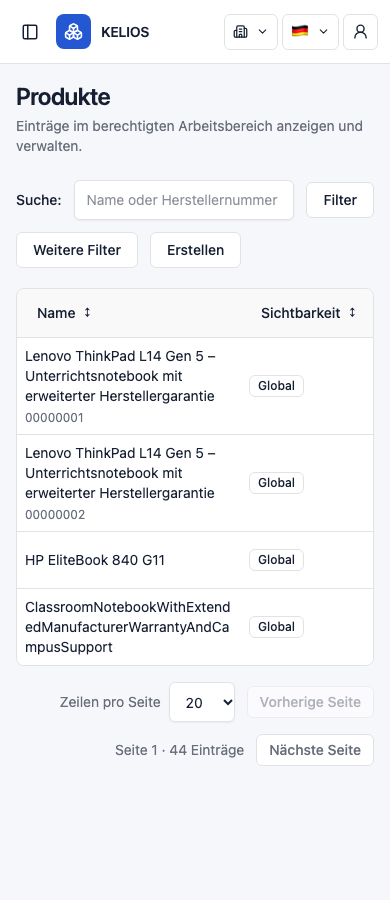
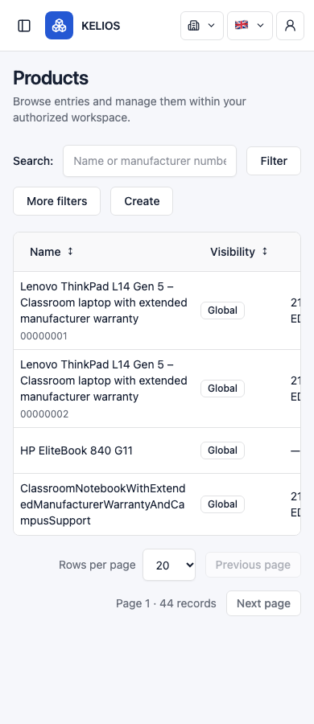

# O2 — bounded Product Name width correction

Date: 2026-10-14. **HUMAN ACCEPTED / CLOSED.** Diagnosis and bounded correction are explicitly human accepted; original verification and limitations below remain unchanged.

Baseline `5f8eb776729219eae58c6d6da0551922ea00f724`. [Accepted diagnosis](O2_PRODUCT_TABLE_DIAGNOSIS.md) retains the original94.14px Name widths,217px(DE)/197px(EN) row heights, screenshots and limitations.

## Exact implementation

- `frontend/src/features/inventory/pages.tsx`: existing Management section receives `product-management` only when kind is products. No element/key/component/query changes; shared Rows implementation unchanged.
- `frontend/src/styles.css`: one scoped selector `.product-management > .table-frame > .data-table > tbody > tr > td:first-child` applies `min-width:14rem` to the existing first (Name) cell only. Current Product column order is explicit and tested. No generic table rules changed.

Existing overflow-wrap:anywhere, scrollable bounded frame, duplicate UUID suffix, manufacturer number and independent detail/reference links remain intact. On mobile, more content requires horizontal table scrolling; this is the existing approved overflow behavior, not hidden or deleted columns. No browser viewport calculations or O6 presentation redesign.

## Focused regression

New `frontend/tests/product-table-readability.spec.ts`: ten cases, eight DE/EN ×390/768/1024/1440 and two neighboring Category/Manufacturer opt-out cases.

Fixtures include long duplicate Product names with distinct UUIDs, short name, unbroken long name, null/long manufacturer number and long identical Category/Manufacturer labels with distinct UUIDs. All API calls are intercepted, including fake authentication. No business writes are allowed by the fixture. Independent detail links are checked against the exact associated UUID.

Assertions cover minimum224px Name width (at the standard16px root), retained wrapping, duplicate row height below150px at390 versus diagnosed197–217px, no page-level horizontal overflow, table-local scroll, same row/input nodes, focus, text selection, unchanged scroll during pending typing, zero extra reads during typing, server sort with pending q excluded, keyboard Tab/Enter into the correct Open action, readable ID-backed detail references and no write requests. Category/Manufacturer computed Name min-width remains0px with no Product class.

All eight final screenshot combinations visually inspected: names remain readable and available in full; no ellipsis clipping or page overflow. Long unbroken tokens still wrap as intended. Representative after-images:

## Commands and exact results

Commands below run from `frontend` unless noted. Logs/screenshots are ignored local artifacts under `.cache/o2-correction/`.

| Command | Result |
|---|---|
| `PATH=/opt/homebrew/opt/node@24/bin:$PATH npm run dev -- --port 12280 --strictPort` | Separate fixture Vite server started; no operator deployment changed |
| `PATH=/opt/homebrew/opt/node@24/bin:$PATH PLAYWRIGHT_BROWSERS_PATH="$PWD/../.cache/playwright" KELIOS_BASE_URL=http://127.0.0.1:12280 npm run test:smoke -- tests/product-table-readability.spec.ts --output=../.cache/o2-correction/browser` |10 passed,0 failed/skipped;12.0s; exit0 |
| Same environment, `npm run test:smoke -- tests/product-table-readability.spec.ts tests/collection-query.spec.ts tests/search-stability.spec.ts --output=../.cache/o2-correction/combined` | **27 passed,0 failed/skipped;32.5s; exit0**. Includes strengthened10 O2,1 existing collection-query and16 search-stability cases |
| `PATH=/opt/homebrew/opt/node@24/bin:$PATH npm test` | **222 passed across11 files**,0 failures/skips;1.88s; exit0 |
| `PATH=/opt/homebrew/opt/node@24/bin:$PATH npm run build` | TypeScript and Vite production build successful; exit0 |
| Root `git diff --check`; document/source links, whitespace and ownership/hash checks | PASS |

The initial focused10 and final27 overlap and must not be added as37 unique tests. The final run strengthened selection-range and Tab navigation assertions without production changes. The production build preceded this test-only strengthening; production bytes stayed unchanged. One initial shell invocation ran from the wrong directory and could not open the intended log path; no suite started. No production/test assertion failure was hidden or counted as passing.

Existing search-stability coverage includes same semantic row/input nodes, equivalent-response selection/table/page scroll, resource/workspace/session stale-response rejection and unchanged token renewal. Existing collection-query coverage verifies coherent applied filters/sort/paging and late-response handling. These are intercepted frontend proofs, not SQL or backend authorization evidence.

## Ownership and limitations

This correction's exact task-owned paths:

1. `frontend/src/features/inventory/pages.tsx`
2. `frontend/src/styles.css`
3. `frontend/tests/product-table-readability.spec.ts`
4. `docs/plans/FRONTEND_UX_AND_FUNCTIONAL_DEFECTS.md` — new correction record only
5. `docs/verification/O2_PRODUCT_TABLE_DIAGNOSIS.md` — appended human acceptance/cross-reference only
6. `docs/verification/O2_PRODUCT_TABLE_CORRECTION.md`
7. `docs/verification/o2-product-table/de-390-corrected.png`
8. `docs/verification/o2-product-table/en-390-corrected.png`

Original diagnosis screenshots and accepted backlog audit remain byte-identical. Pre-existing deployment/INVENTORY/IDE/historical artifacts are excluded. The pre-task SHA256 snapshot is `.cache/o2-correction/before.json`; preservation checks allow only the eight paths above. The production patch is one JSX attribute and one CSS rule. No backend/API/query, locale, shared Rows, schema, deployment or operator-data changes.

No real backend, operator data, touch device or screenreader testing; no new manual/live claim. No full browser/backend suite required or run. The existing development-server react-i18next warning was not repaired as part of O2. Temporary fixture server is stopped after verification. No staging/commit or next gate. STOP for human acceptance of the bounded correction.

## Human correction acceptance

The human explicitly accepted the bounded O2 correction as **HUMAN ACCEPTED / CLOSED**. Historical execution-time statements, results and limitations above are preserved. Commit preparation is separately authorized only for the recorded eight-path/hunk boundary; this acceptance does not expand that manifest.
