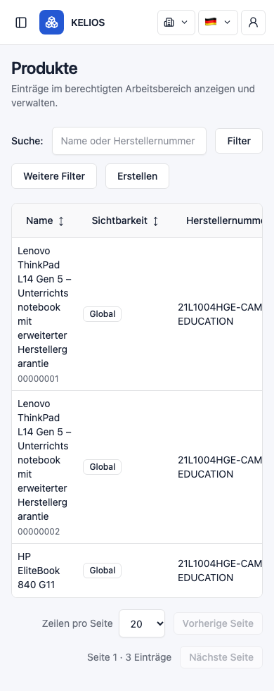
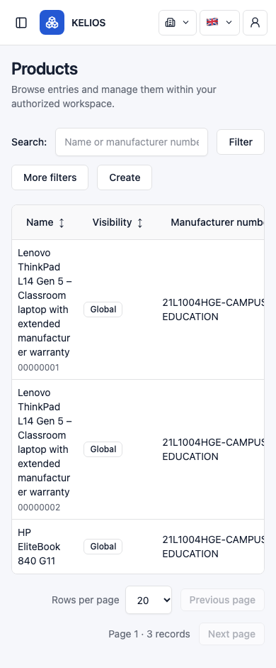

# O2 — Product table readability diagnosis

Date: 2026-10-14. Baseline `5f8eb776729219eae58c6d6da0551922ea00f724`. **Diagnosis IMPLEMENTED / PENDING HUMAN ACCEPTANCE. Defect reproduced; correction NOT AUTHORIZED and not implemented.**

## Scope and evidence boundary

Human authorized diagnosis only. Current worktree served through a separate local Vite fixture server at127.0.0.1:12280. All `/api/v1/**` requests intercepted, including fake auth refresh/CSRF. No operator backend, account, Provider, data or deployment accessed. Browser contexts were disposable. No UI/CSS mutation or proposed-fix experiment performed.

Historical basis: [B.4](PHASE_B_4_TABLE_UX_AND_CONFIRMATION.md) recorded heavy Product Name wrapping at390px; [UX plan](../plans/FRONTEND_UX_AND_FUNCTIONAL_DEFECTS.md) retains the limitation independently of accepted query work.

Fixture: three GLOBAL Products, two equal long names with different UUIDs (visible suffixes00000001/00000002), a shorter HP EliteBook name, manufacturer number `21L1004HGE-CAMPUS-EDUCATION`. Long names: DE `Lenovo ThinkPad L14 Gen 5 – Unterrichtsnotebook mit erweiterter Herstellergarantie`; EN `Lenovo ThinkPad L14 Gen 5 – Classroom laptop with extended manufacturer warranty`. Category names `Notebooks für naturwissenschaftliche Fachräume / Science classroom notebooks` and Manufacturer names `Lenovo Deutschland – Education & Campus Solutions` intentionally repeat with distinct reference UUIDs. Current nested association DTO shape and Page0/size20 metadata used. These are fictional intercepted rows, not database records.

Important scope fact: Product list renders Name, Visibility, Manufacturer number, Open; Category/Manufacturer labels are not list columns. Their long/duplicate projections do not cause this list geometry. Independent Product detail renders the readable links; DE/EN390 detail screenshots were inspected. Do not add association columns or selectors for this repair.

## Reproduction and measured geometry

Chromium headless, CSS-pixel widths390/768/1024/1440, height900, DE/EN. Eight Product observations plus eight Manufacturer comparison observations completed; these are diagnostic observations, not a full regression-suite count.

| Language / viewport | Frame outer width | Table width | Name cell width | Duplicate long-name row height |
|---|---:|---:|---:|---:|
| DE390 |358|505.86|94.14|217|
| EN390 |358|496.78|94.14|197|
| DE768 |720|718|239.1|97|
| EN768 |720|718|259.2|97|
| DE1024 |768|766|264.0|97|
| EN1024 |768|766|276.5|97|
| DE1440 |1152|1150|396.4|77|
| EN1440 |1152|1150|415.2|77|

Document scrollWidth equals viewport width in all eight observations: **no page-level horizontal overflow reproduced**. At390 the frame clientWidth is356 and its content scrollWidth is506(DE)/497(EN). Horizontal table scrolling is functional containment, not itself the defect. Name cell content has only about78px after two8px paddings. DE words split as `Unterrichts` / `notebook`, `Herstellerg` / `arantie`; EN `manufactur` / `er`. A long duplicate name occupies roughly nine(DE)/eight(EN) text lines plus UUID suffix; rows are visually inefficient and hard to scan. The Open column lies beyond the initial frame view.

## Exact cause and shared boundary

[pages.tsx](../../frontend/src/features/inventory/pages.tsx), `Rows` lines68–72 and `Management` lines155–175:

- Rows creates `.table-frame > table.data-table` with automatic table layout and stable row IDs.
- Product passes four columns including the Open action; Name has no resource-specific minimum width.
- Sortable headers use no-wrap Button/header content; Open cell is also no-wrap.
- Duplicate-name UUID suffix is a second block inside Name; this adds height but is required disambiguation and must stay.

[styles.css](../../frontend/src/styles.css) lines18–21:

- frame: max-width100%, overflow-x:auto;
- table: width100%, automatic layout;
- headers: white-space:nowrap;
- cells: max-width16rem, overflow-wrap:anywhere, no minimum width.

The auto-layout minimum-content calculation can shrink Name nearly to the short Name header, because `anywhere` allows arbitrary word breaks. Other no-wrap headers reserve135.23px visibility/175.03px number/101.45px Open in DE, pushing the table wider than its frame while still compressing Name. Actual Name/body padding is8px from Rows utilities; the generic CSS alone is not the computed padding.

The mechanism is shared, but Product's additional number column amplifies it. The same long Manufacturer label at390 yields a119.3px DE Name cell/137px row and152.8px EN/97px row, compared with Product94.14px/217 or197px. This comparison does not authorize redesign of all tables. O2 should opt in only for Product.

## Preservation observations

In all eight Product scenarios, typing `Pending text` generated zero additional requests; the search input and first row retained the same DOM node, focus stayed in the input. At390, table scrollLeft60 remained60 while typing; at wider widths it remained0 because there was no table overflow. Initial list request retained server Page semantics; fixture order was rendered unchanged. Product Open used its UUID detail GET. No business mutation was sent; only intercepted authentication refresh used POST.

These observations are narrow preservation baselines, not proof of all query/concurrency/keyboard/assistive behavior. No real-backend SQL, manual business-data sorting, touch device or screenreader coverage is claimed.

## Smallest proposed correction — separate authorization required

Give **Product Name cells only** a readable minimum inline width (initial implementation candidate14rem, to verify rather than assert as already successful), retaining wrapping for long words and the existing bounded horizontal table frame. Prefer one explicit Product-table opt-in class passed to Rows plus a scoped CSS rule; retain existing DOM structure, keys, sorting buttons, order and duplicate UUID suffix. No viewport JS, ellipsis-only loss of names, hiding fields, extra queries or O6 filter redesign.

Expected production files: `frontend/src/features/inventory/pages.tsx` (small Product opt-in hook) and `frontend/src/styles.css` (scoped name-cell minimum). A single local utility approach is acceptable if it scopes the same behavior clearly without global table changes. Expected focused regression file: new `frontend/tests/product-table-readability.spec.ts`, reusing existing fixture conventions. No generic table framework or backend/API change.

Required future verification after explicit patch authorization:

1. DE/EN at390/768/1024/1440 with long, short, duplicate, unbroken-name and null/long-number fixtures. Assert usable Name width, reduced pathological wrapping, preserved full text/UUID disambiguation and no page-level overflow. Visually inspect all eight combinations.
2. Table-local scroll exposes all headers and Open actions; keyboard Tab reaches controls and opens the correct UUID. Preserve input/row node identity, focus, scroll during pending edits/refresh, and duplicate reference IDs.
3. Sort/filter/page still send server requests with applied criteria; pending text sends none and never leaks. Verify neighboring Manufacturer/Category layouts unchanged by opt-in scope.
4. Focused browser tests plus relevant existing collection/search-stability preservation coverage, units as appropriate to actual code delta, production build, diff/preservation checks. No real writes/operator data.

The14rem candidate has not been applied or measured. If it requires wider shared changes, stop for human scope review.

## Commands, results and limitations

- Fixture server: from frontend, `PATH=/opt/homebrew/opt/node@24/bin:$PATH npm run dev -- --port 12280 --strictPort`. Initial sandbox bind failed EPERM; authorized elevated invocation started successfully. This was a separate temporary dev server, not a deployment.
- Diagnostic runner: `PLAYWRIGHT_BROWSERS_PATH="$PWD/.cache/playwright" /opt/homebrew/opt/node@24/bin/node .cache/o2-diagnosis/probe.mjs`. Initial sandbox Chromium launch denied MachPort; elevated run completed exit0. Second focused run added distinct same-label reference UUIDs and explicit scroll measurement; all16 observations completed exit0. No production patch between runs.
- Ignored runner/results and remaining screenshots: `.cache/o2-diagnosis/`. Two390 Product screenshots are retained above. No full unit/browser/backend suite or production build run for diagnosis.
- The temporary Vite server was stopped after observation (SIGINT/exit130); operator runtime was untouched. Its console logged react-i18next `NO_I18NEXT_INSTANCE` warnings while both languages visibly rendered correctly. No warning repair or causal connection to table geometry is claimed.
- Static source, relative-link, whitespace, `git diff --check` and pre-task hash preservation checks. Only report, two fixture screenshots and a narrow UX-plan diagnosis entry belong to this gate. The accepted remaining-plan audit and all unrelated dirty content stay unchanged.

STOP for human review. O2 correction remains NOT AUTHORIZED; no implementation or next gate.

## Human diagnosis acceptance

The human explicitly accepted O2 diagnosis as **HUMAN ACCEPTED / CLOSED** and separately authorized the bounded correction. Original diagnosis measurements, commands and limitations above remain historical. See [correction evidence](O2_PRODUCT_TABLE_CORRECTION.md) for the implementation; correction acceptance remains a separate human decision.
